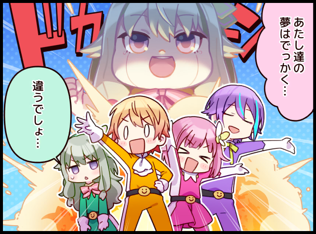

# myHCMUS - Events and Conduct Scores Manager

For our CS300 (Elements of Software Engineering) project, we built **myHCMUS**, a web-based platform designed to simplify the management of extracurricular activities and student conduct scores at HCMUS.

# Description
The platform allows students to discover and register for extracurricular activities, track their participation, monitor their training scores, and access university services through a centralized dashboard. It also provides organizers and administrators with tools to manage activities, registrations, attendance, participation records, and system-wide information efficiently.

By bringing these services together in one platform, myHCMUS aims to improve the student experience, reduce administrative workload, and make extracurricular activity management more transparent and accessible.

Some key features include activity discovery and managenent, training score management, calendars, and system administration.

# AI Student Assistant
The thing that makes the project stand out is a very own AI student assistant. The AI Student Assistant helps students discover extracurricular activities that match their interests and needs.

It provides personalized activity recommendations based on factors such as:

- Student interests and preferences.
- Personal schedules and activity availability.
- Previous participation history.
- Training-score requirements and goals.

The assistant aims to reduce the time students spend searching for activities and help them make informed decisions about extracurricular participation.

# Installation
TBA

# Build
TBA