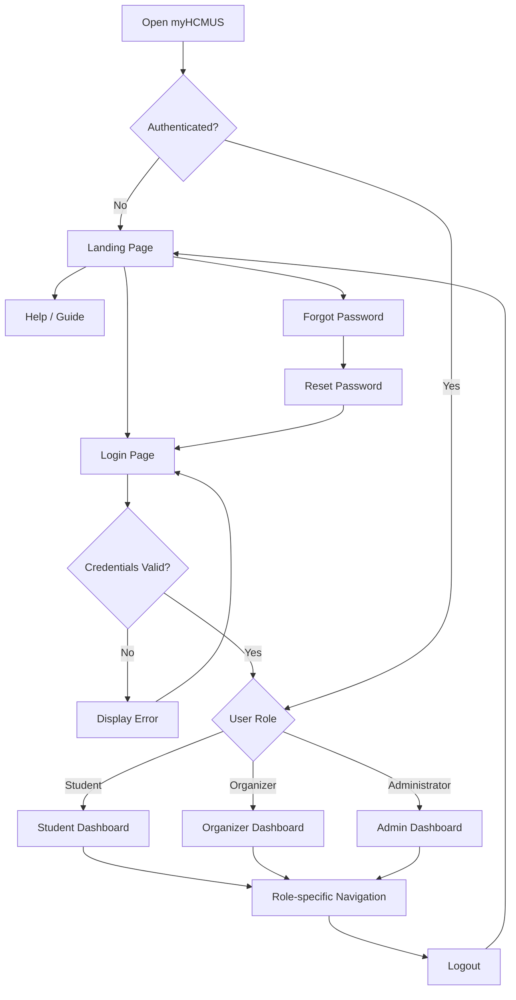

# myHCMUS - Overview 
- **Purpose**:  To document the navigation flows and user interactions in myHCMUS system.
- **Scope**: Cover the navigation flows of public pages and authenticated pages, including the role-based navigations for different roles.
- **Target Users**: University students and staff at VNU-HCMUS.
- **User Roles**:
    - Student
    - Organizer
    - Administrator

# 2. Global Navigation Flow

# 3. Public User Flow

## 3.1 Landing Page
## 3.2 Login Page

# 4. Authenticated User Flow 

## A. Student Flow
### Student Dashboard

## B. Organizer/Staff Flow
### Organizer Dashboard

## C. Administrator Flow
### AD Dashboard
## D. Cross-role Flow
