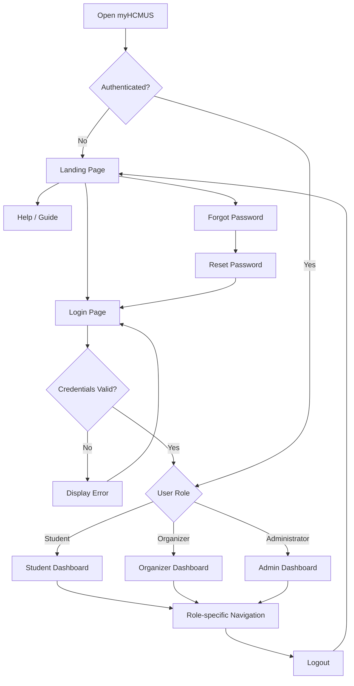

# 1. Global Navigation Flow

## 1.1 Entry Point

Users can access myHCMUS via website url

- Unauthenticated users are directed at the [Landing Page](./pages/common.md#landing-page)
- Authenticated users are directed to role-based Dashboard ([Student Dashboard](./pages/student.md#dashboard), [Organizer Dashboard](./pages/organizer.md#dashboard), [Admin Dashboard](./pages/admin.md#dashboard))
- Users logging out their account are linked back to [Landing Page](./pages/common.md#landing-page)

## 1.2 Public Navigation

Unauthenticated users can access the following pages:

- **[Landing Page](./pages/common.md#landing-page)**: The first sight of myHCMUS, including the introduction, key highlights.
- **[Login Page](./pages/common.md#login-page)**: Allow users to authenticate.
- **[Forgot Password](./pages/common.md#forgot-password)** (OPTIONAL): Users request password recovery.
- **[Help/Guide Page](./pages/common.md#help--guide)**: Instructions and most frequent questions.

## 1.3 Authentication Navigation

1. Users open [Login Page](./pages/common.md#login-page).
2. Users enter account credentials
3. (OPTIONAL) If they forgot their password then re-direct to [Forgot Password](./pages/common.md#forgot-password).
4. System validates the creadentials
5. If authentication succeeds, system identifies the user's role.
6. If authentication fails, reset the credentials and display the error message.

## 1.4 Role-Based Direction

After the authentication succeeds and identifies the user's role, redirect to the specific Dashboard for their assigned role.

- **Student**: [Student Dashboard](./pages/student.md#dashboard).
- **Organizer**: [Organizer Dashboard](./pages/organizer.md#dashboard).
- **Administrator**: [Admin Dashboard](./pages/admin.md#dashboard).

## 1.5 Authentication Navigation

Authenticated users can access with role-based pages on the sidebar navigation:

- **Student**: [Dashboard](./pages/student.md#dashboard), [Activities](./pages/student.md#activities), [DRS Management](./pages/student.md#drs-management), [My Registrations](./pages/student.md#my-registrations), [Calendar](./pages/student.md#calendar), [AI Student Assistant](./pages/student.md#ai-student-assistant), [University Services](./pages/student.md#university-services), [Profile](./pages/common.md#profile).
- **Organizer**: [Activity Management](./pages/organizer.md#activity-management), [Registration Management](./pages/organizer.md#registration-management), [Attendance and Results](./pages/organizer.md#attendance-and-results), [Appeals](./pages/organizer.md#appeals), [Reports](./pages/organizer.md#reports), [Profile](./pages/common.md#profile).
- **Administrator**: [User Management](./pages/admin.md#user-management), [Activity Categories](./pages/admin.md#activity-categories), [System Configuration](./pages/admin.md#system-configuration), [Reports and Analytics](./pages/admin.md#reports-and-analytics), and [Audit Logs](./pages/admin.md#audit-logs).