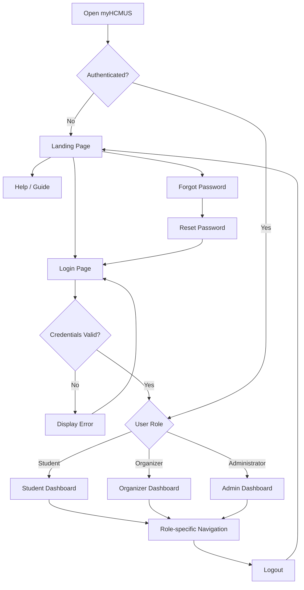

# myHCMUS - Overview 
- **Purpose**:  To document the navigation flows and user interactions in myHCMUS system.
- **Scope**: Cover the navigation flows of public pages and authenticated pages, including the role-based navigations for different roles.
- **Target Users**: University students and staff at VNU-HCMUS.
- **User Roles**:
    - Student
    - Organizer
    - Administrator

# 2. Global Navigation Flow

## 2.1 Entry Point
Users can access myHCMUS via website url

- Unauthenticated users are directed at the [Landing Page](#31-landing-page)
- Authenticated users are directed to role-based Dashboard ([Student Dashboard](#student-dashboard), [Organizer Dashboard](#organizer-dashboard), [Admin Dashboard](#ad-dashboard))
- Users logging out their account are  linked back to [Landing Page](#31-landing-page)

## 2.2 Public Navigation 
Unauthenticated users can access the following pages:

- **[Landing Page](#31-landing-page)**: The first sight of myHCMUS, including the introduction, key highlights.
- **[Login Page](#32-login-page)**: Allow users to authenticate.
- **[Forgot Password](#33-forgot-password)** (OPTIONAL): Users request password recovery.
- **[Help/Guide Page](#34-helpguide-page)**: Instructions and most frequent questions.

## 2.3 Authentication Navigation

1. Users open [Login Page](#32-login-page).
2. Users enter account credentials
3. (OPTIONAL) If they forgot their password then re-direct to [Forgot Password](#33-forgot-password).
4. System validates the creadentials
5. If authentication succeeds, system identifies the user's role.
6. If authentication fails, reset the credentials and display the error message.

## 2.4 Role-Based Direction
After the authentication succeeds and identifies the user's role, redirect to the specific Dashboard for their assigned role.

- **Student**: [Student Dashboard](#student-dashboard).
- **Organizer**: [Organizer Dashboard](#organizer-dashboard).
- **Administrator**: [Admin Dashboard](#ad-dashboard).  

## 2.5 Authentication Navigation 
Authenticated users can access with role-based pages on the sidebar navigation:

- **Student**: Dashboard, Activities, DRS Management, My Registrations, Calendar, AI Student Assistant, University Services, Profile.
- **Organizer**: Activity Management, Registration Management, Attendance and Results, Appeals, Reports, Profile.
- **Administrator**: User Management, Activity Categories, System Configuration, Reports and Analytics, and Audit Logs.

# 3. Public User Flow

## 3.1 Landing Page
## 3.2 Login Page
## 3.3 Forgot Password
## 3.4 Help/Guide Page

# 4. Authenticated User Flow 

## A. Student Flow
### Student Dashboard

## B. Organizer/Staff Flow
### Organizer Dashboard

## C. Administrator Flow
### AD Dashboard
## D. Cross-role Flow
