# 1. Global Navigation Flow

## 1.1 Entry Point

Users can access myHCMUS via website url

- Unauthenticated users are directed at the [Landing Page](./pages/common.md#landing-page)
- Authenticated users are directed to role-based Dashboard ([Student Dashboard](./pages/student.md#dashboard), [Organizer Dashboard](./pages/organizer.md#dashboard), [Admin Dashboard](./pages/admin.md#dashboard))
- Users logging out their account are linked back to [Landing Page](./pages/common.md#landing-page)

## 1.2 Public Navigation

Unauthenticated users can access the following pages:

- **[Landing Page](./pages/common.md#landing-page)**: The first sight of myHCMUS, including the introduction, key highlights.
- **[Login Page](./pages/common.md#login-page)**: Allow users to authenticate.
- **[Forgot Password](./pages/common.md#forgot-password)** (OPTIONAL): Users request password recovery.
- **[Help/Guide Page](./pages/common.md#help--guide)**: Instructions and most frequent questions.

## 1.3 Authentication Navigation

1. Users open [Login Page](./pages/common.md#login-page).
2. Users enter account credentials
3. (OPTIONAL) If they forgot their password then re-direct to [Forgot Password](./pages/common.md#forgot-password).
4. System validates the creadentials
5. If authentication succeeds, system identifies the user's role.
6. If authentication fails, reset the credentials and display the error message.

## 1.4 Role-Based Direction

After the authentication succeeds and identifies the user's role, redirect to the specific Dashboard for their assigned role.

- **Student**: [Student Dashboard](./pages/student.md#dashboard).
- **Organizer**: [Organizer Dashboard](./pages/organizer.md#dashboard).
- **Administrator**: [Admin Dashboard](./pages/admin.md#dashboard).

## 1.5 Authentication Navigation

Authenticated users can access with role-based pages on the sidebar navigation:

- **Student**: [Dashboard](./pages/student.md#dashboard), [Activities](./pages/student.md#activities), [DRS Management](./pages/student.md#drs-management), [My Registrations](./pages/student.md#my-registrations), [Calendar](./pages/student.md#calendar), [AI Student Assistant](./pages/student.md#ai-student-assistant), [University Services](./pages/student.md#university-services), [Profile](./pages/common.md#profile).
- **Organizer**: [Activity Management](./pages/organizer.md#activity-management), [Registration Management](./pages/organizer.md#registration-management), [Attendance and Results](./pages/organizer.md#attendance-and-results), [Appeals](./pages/organizer.md#appeals), [Reports](./pages/organizer.md#reports), [Profile](./pages/common.md#profile).
- **Administrator**: [User Management](./pages/admin.md#user-management), [Activity Categories](./pages/admin.md#activity-categories), [System Configuration](./pages/admin.md#system-configuration), [Reports and Analytics](./pages/admin.md#reports-and-analytics), and [Audit Logs](./pages/admin.md#audit-logs).

## 1.6 Global Flow Overview

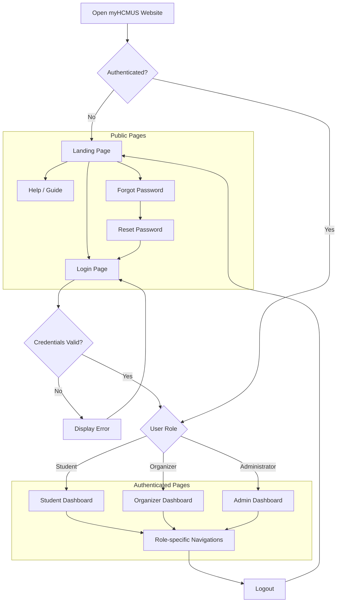

# 2. Public User Flow

## 2.1 Landing Page Flow

**Page Description:** [Landing Page](./pages/common.md#landing-page)

**Actor:** Guest (Unauthenticated users)

### Main Flow

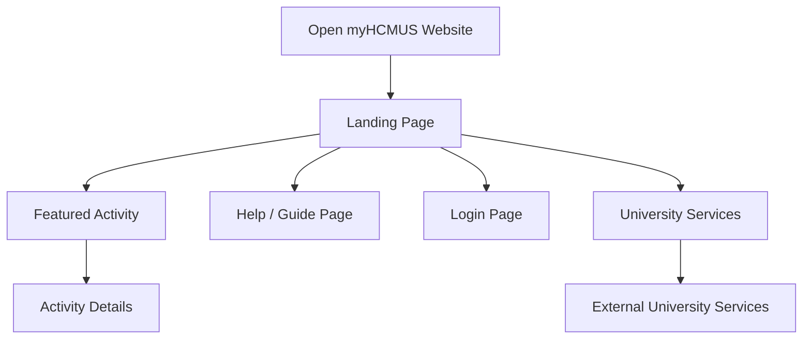

1. User opens the myHCMUS website.
2. System displays the [Landing Page](./pages/common.md#landing-page).
3. User can:
   - Navigate to the featured activity details.
   - Navigate to the [Help /Guide Page](./pages/common.md#help--guide).
   - Navigate to the  [Login Page](./pages/common.md#login-page).
   - Access available university services.

### Exit Points
- [Login Page](./pages/common.md#login-page)
- [Help / Guide Page](./pages/common.md#help--guide)
- Activity Details
- External University Services

## 2.2 Login Page Flow

**Page Description**: [Login Page](./pages/common.md#login-page)

**Actor:** Guest (Unauthenticated users)

### Main Flow
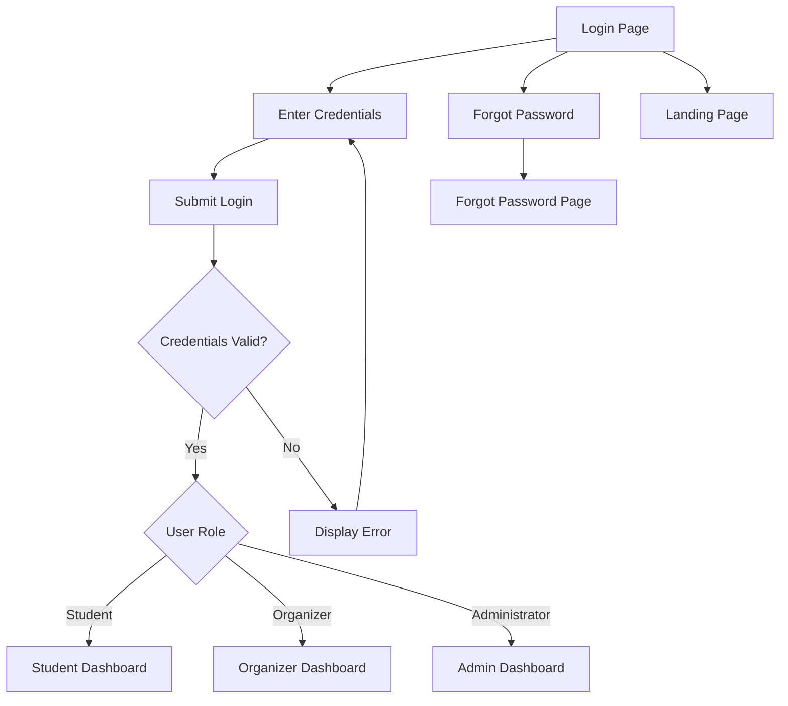

1. User opens the [Login Page](./pages/common.md#login-page).
2. User enters account credentials.
3. User submits the login form.
4. System validates the credentials.
5. If authentication succeeds, system identifies the user's role.
6. System redirects the user to the corresponding Dashboard.
7. If authentication fails, system displays an error message and allows the user to retry.
8. User can navigate to the [Forgot Password Page](./pages/common.md#forgot-password).
9. User can back to the [Landing Page](./pages/common.md#landing-page).

### Exit Points
- [Student Dashboard](./pages/student.md#dashboard)
- [Organizer Dashboard](./pages/organizer.md#dashboard)
- [Admin Dashboard](./pages/admin.md#dashboard)
- [Forgot Password](./pages/common.md#forgot-password)
- [Landing Page](./pages/common.md#landing-page)

## 2.3 Forgot Password Flow

## 2.4 Reset Password Flow

## 2.5 Help / Guide Flow

**Page Description:** [Help / Guide](./pages/common.md#help--guide)

**Actor:** Guest (Unauthenticated users)

### Main Flow
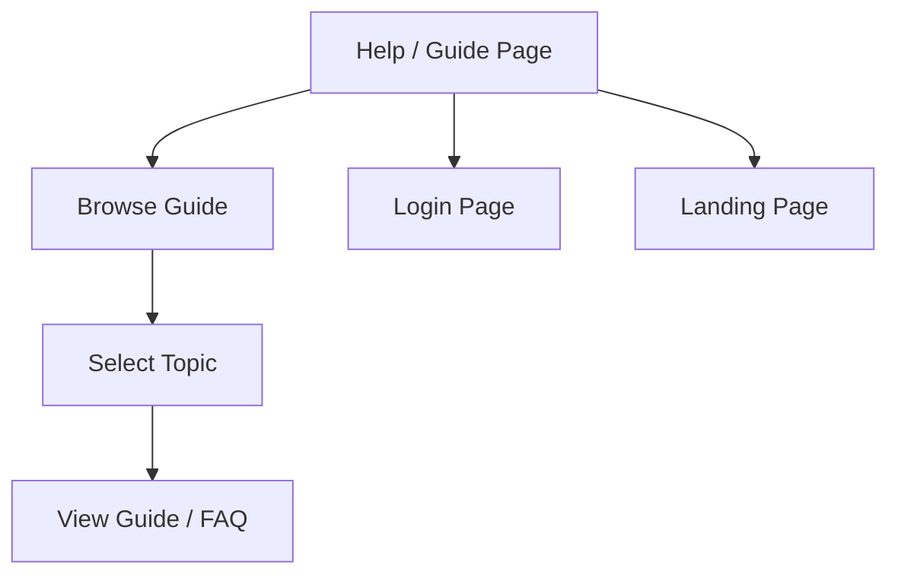
1. User opens the [Help / Guide Page](./pages/common.md#help--guide).
2. System displays available guides and frequently asked questions.
3. User selects a topic.
4. System displays the corresponding guide or FAQ.
5. User can navigate to the [Login Page](./pages/common.md#login-page).
6. User can return to the [Landing Page](./pages/common.md#landing-page).

### Exit Point
- [Landing Page](./pages/common.md#landing-page)
- [Login Page](./pages/common.md#login-page)

## 2.6 Public User Flow Overview

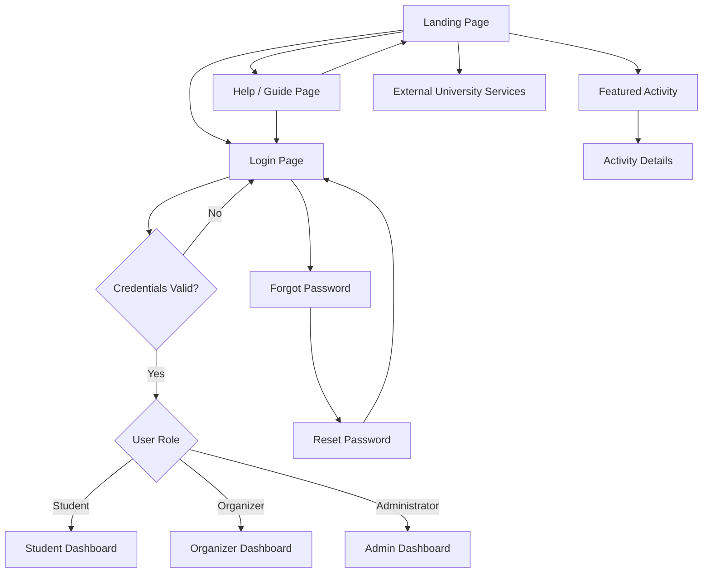

# 3. Authenticated User Flow

## 3.1 Student Flow

### 3.1.1 Student Dashboard

**Page Description:** [Student Dashboard](./pages/student.md#student-dashboard)

**Actor:** Student

#### Main Flow
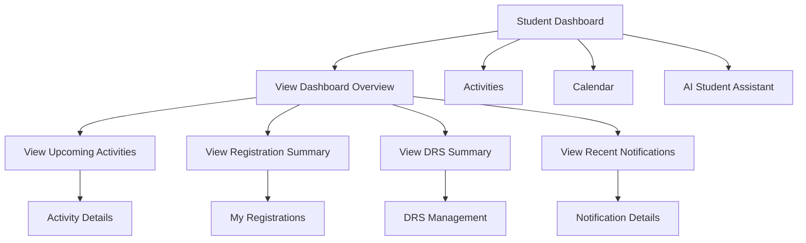

1. User opens the [Student Dashboard](./pages/student.md#student-dashboard).
2. System displays an overview of the student's current activities and information.
3. User can view upcoming activities, registration summary, DRS summary, and recent notifications.
4. User can navigate from an upcoming activity to its [Activity Details](./pages/student.md#activity-details).
5. User can navigate from the registration summary to [My Registrations](./pages/student.md#my-registrations).
6. User can navigate from the DRS summary to [DRS Management](./pages/student.md#drs-management).
7. User can select a notification to view its details.
8. User can navigate directly to [Activities](./pages/student.md#activities), [Calendar](./pages/student.md#calendar), or [AI Student Assistant](./pages/student.md#ai-student-assistant).

#### Exit Points
- [Activity Details](./pages/student.md#activity-details)
- [Activities](./pages/student.md#activities)
- [My Registrations](./pages/student.md#my-registrations)
- [DRS Management](./pages/student.md#drs-management)
- [Calendar](./pages/student.md#calendar)
- [AI Student Assistant](./pages/student.md#ai-student-assistant)
- [Notification Details](./pages/student.md#notification-details)

### 3.1.2 Activities

**Page Description:** [Activities](./pages/student.md#activities)

**Actor:** Student

#### Main Flow

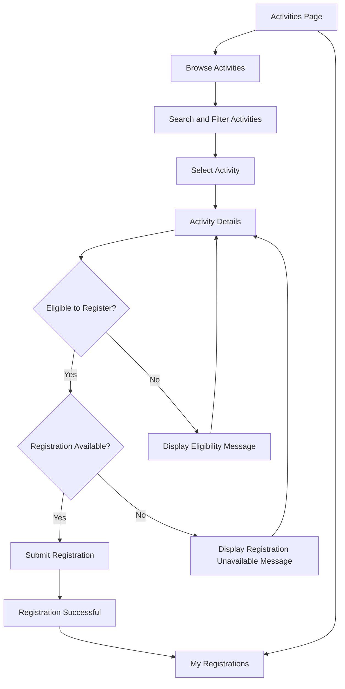

1. User opens the [Activities](./pages/student.md#activities) page.
2. System displays available activities.
3. User browses activities or searches and filters activities based on available criteria.
4. User selects an activity to view its [Activity Details](./pages/student.md#activity-details).
5. System checks whether the student is eligible to register for the activity.
6. If the student is not eligible, the system displays the eligibility requirements or an appropriate message.
7. If the student is eligible, the system checks whether registration is currently available.
8. If registration is unavailable, the system displays an appropriate message.
9. If registration is available, the student can submit a registration request.
10. System processes the registration and displays the registration result.
11. After a successful registration, the student can navigate to [My Registrations](./pages/student.md#my-registrations).

#### Exit Points
- [Activity Details](./pages/student.md#activity-details)
- [My Registrations](./pages/student.md#my-registrations)
- [Student Dashboard](./pages/student.md#student-dashboard)

### 3.1.3 My Registrations
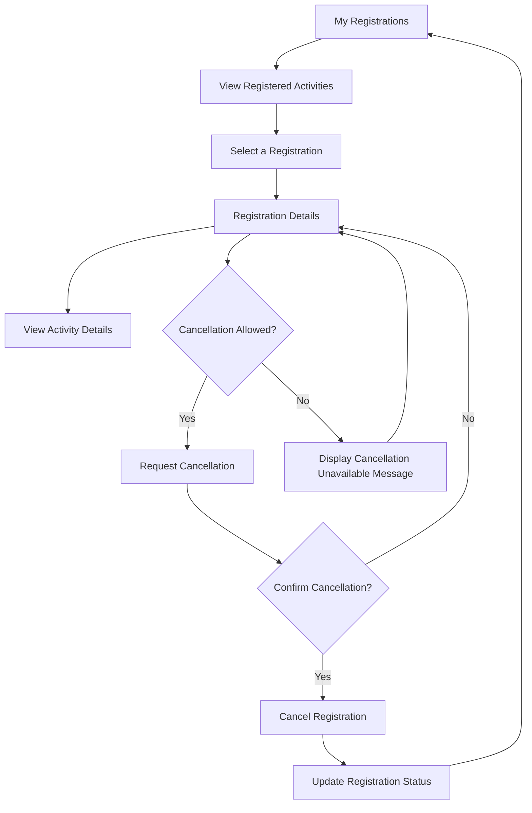

### 3.1.4 DRS Management
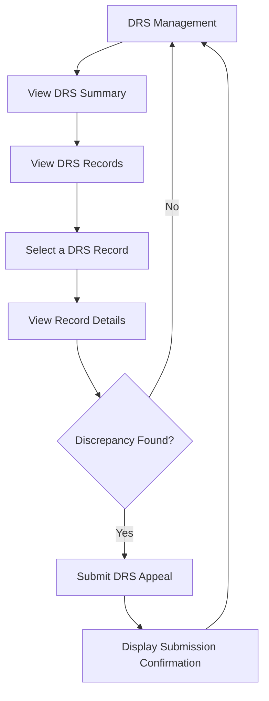

### 3.1.5 Calendar
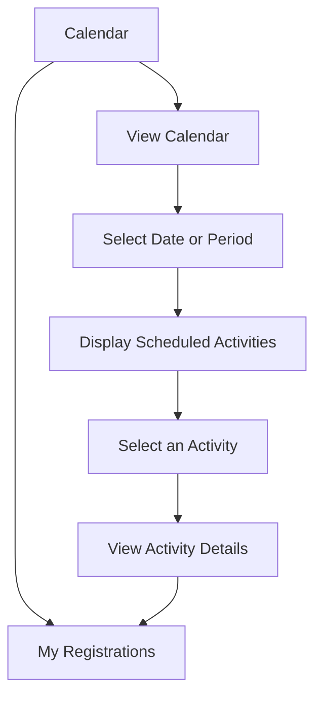

### 3.1.6 AI Student Assistant
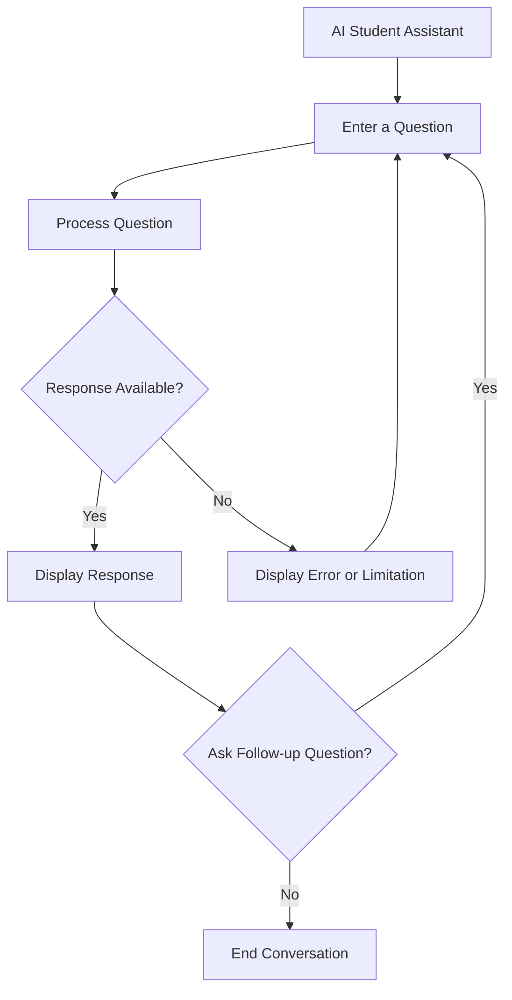

### 3.1.7 University Services
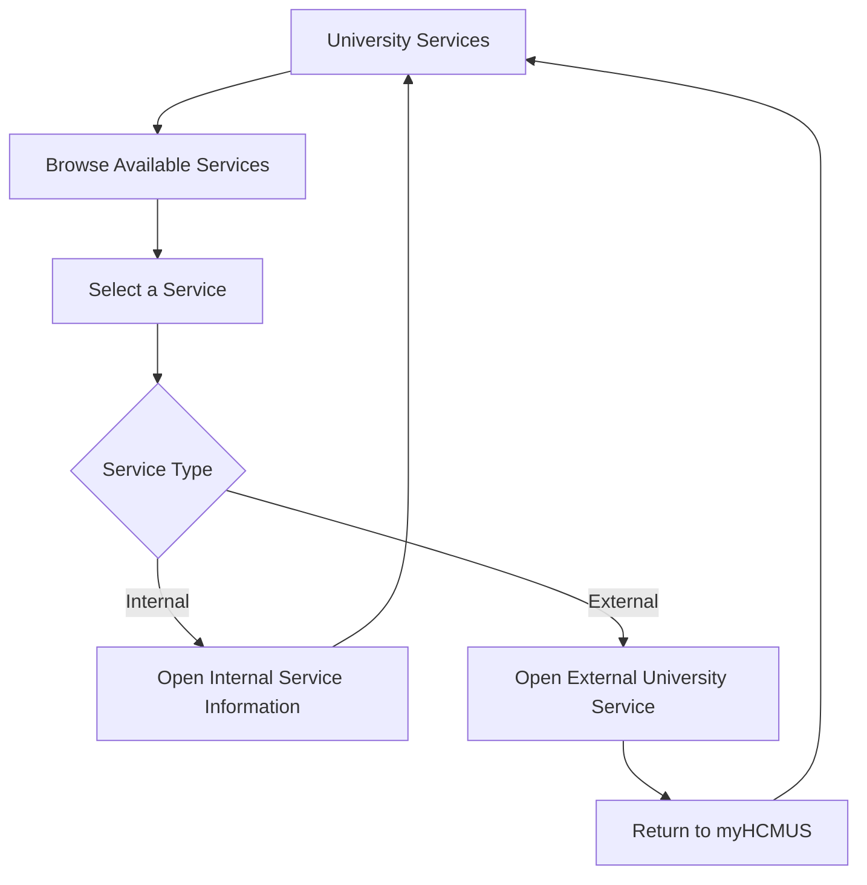

### 3.1.8 Profile
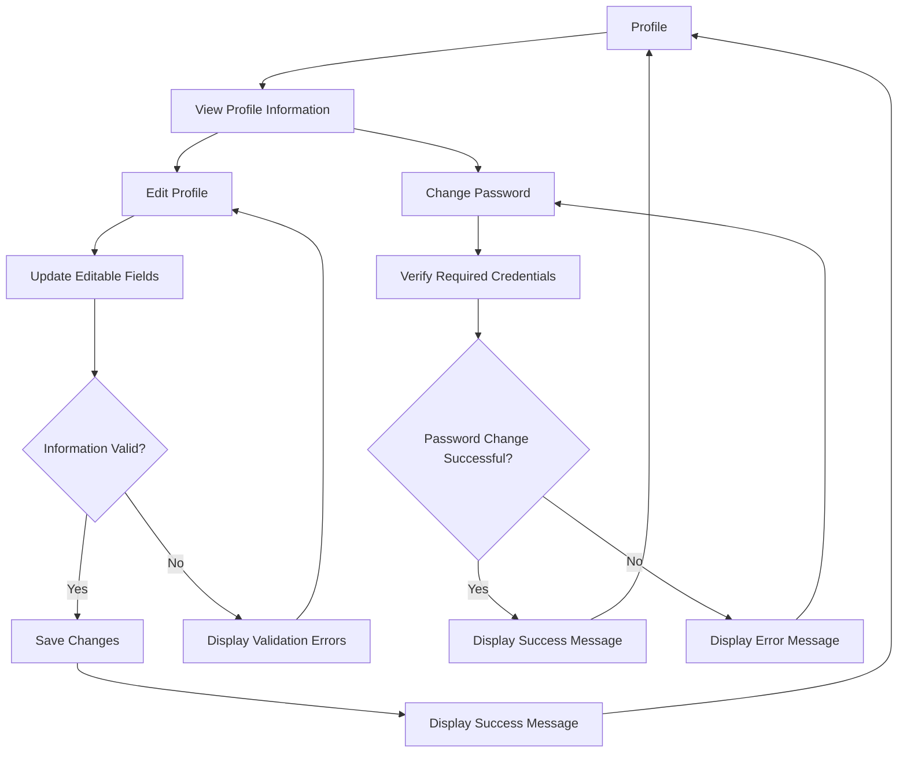

### 3.1.9 Notifications
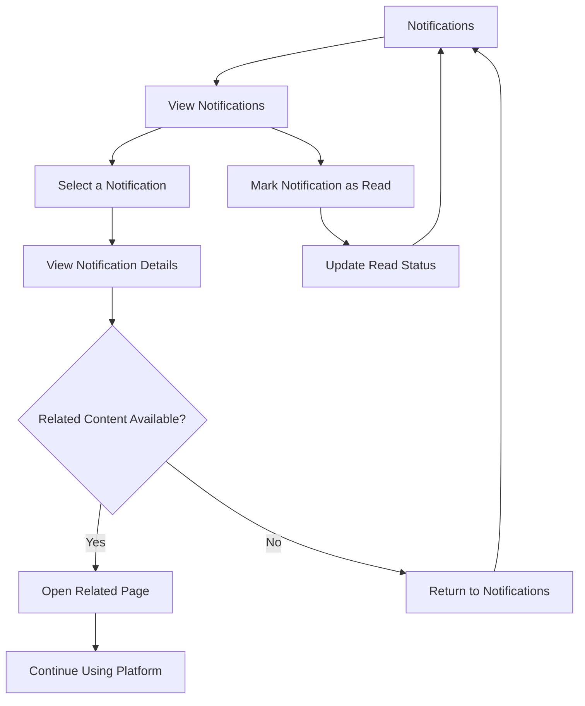

## 3.2 Organizer Flow

### 3.2.1 Organizer Dashboard

### 3.2.2 Activity Management

### 3.2.3 Registration Management

### 3.2.4 Attendance and Results

### 3.2.5 Appeals

### 3.2.6 Reports

### 3.2.7 Profile

### 3.2.8 Organizer Flow Overview
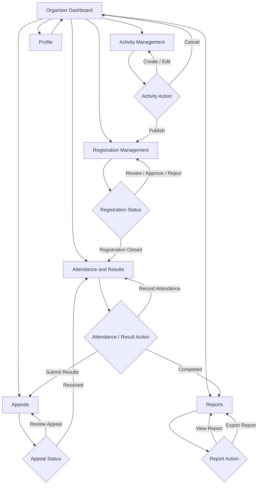

## 3.3 Administrator Flow

### 3.3.1 Administrator Dashboard

### 3.3.2 User Management

### 3.3.3 Activity Categories

### 3.3.4 System Configuration

### 3.3.5 Reports and Analytics

### 3.3.6 Audit Logs

### 3.3.7 Profile

# 4. Cross-role User Flows

## 4.1 Activity Registration and Participation

## 4.2 Attendance and DRS Result Submission

## 4.3 DRS Appeal and Resolution

## 4.4 Activity Cancellation and Notifications

# 5. Alternative and Error Flows

## 5.1 Authentication Failure

## 5.2 Unauthorized Access

## 5.3 Registration Deadline Passed

## 5.4 Activity Capacity Reached

## 5.5 Schedule Conflict

## 5.6 Activity Cancelled

## 5.7 Session Expiration