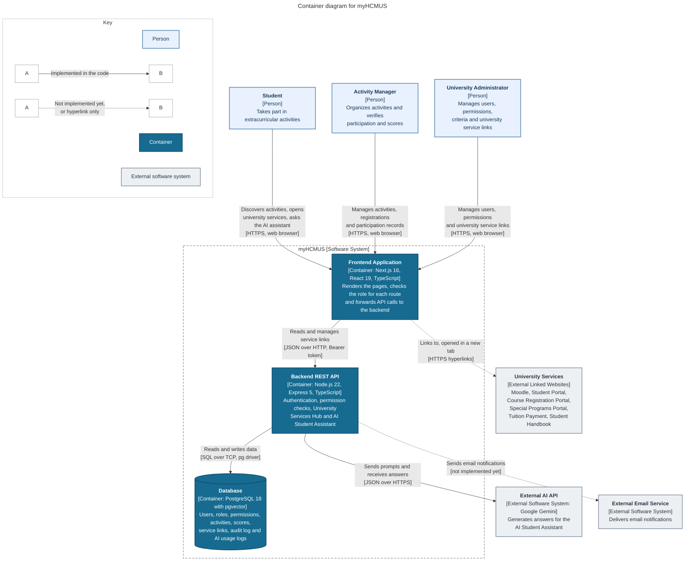

# Software Architecture: Container Diagram (C4 Level 2)
**Workers:** Phan Minh Khôi  
**Reviewers:**  
**Editors:**

**Version:** 1.0.0  
**Amendment:** 2026/11/28

## 1. Purpose and scope

This document zooms into the myHCMUS software system from the [System Context Diagram](system-context-diagram.md) (C4 Level 1) and shows its containers, the technology of each one, and how they communicate. It belongs to PA4 section C (C4 Model, Level 2). The inside of the two application containers is described in the [Frontend Component Diagram](../fe/component-diagram-fe.md) and the [Backend Component Diagram](../be/component-diagram-be.md) (C4 Level 3).

In the C4 Model a *container* is an application or a data store that must be running for the system to work. It is not a Docker container, although two of our containers do run in Docker.

The diagram reflects the `dev` branch at commit `95b150f` (2026/11/28), after the PA4 functional groups were merged. The people and external systems have the same names as in the System Context Diagram.

## 2. Container diagram

**Key.** Light blue boxes are people, dark blue boxes are containers of myHCMUS, and grey boxes are external software systems. These are the colours of the System Context Diagram. The dashed border is the boundary of myHCMUS. Each arrow points in the direction of the request and is labelled with its purpose and, in brackets, its technology or protocol. A solid arrow is a connection that is implemented in the code on `dev`. A dashed arrow is a connection that is not implemented yet or, for University Services, a plain hyperlink with no data exchange, as in the System Context Diagram. A solid arrow does not mean every feature behind it works end to end: [section 5](#5-current-state-of-the-connections) lists the limits.

## 3. Explanation of the diagram

Students, Activity Managers and University Administrators use myHCMUS through a web browser and only ever talk to the **Frontend Application**. It renders the pages and checks which pages each role may open. When a page needs data from the server (with `NEXT_PUBLIC_DATA_SOURCE=api`), the browser calls the Frontend Application's forwarding route, which calls the **Backend REST API** with a Bearer token. The browser never calls the backend directly and never sees that token. The Backend REST API holds the business rules and permission checks. It is the only container that talks to the **Database**, so every read and write passes through the same checks.

The three external systems match the System Context Diagram. The Backend REST API sends the AI Student Assistant's questions to the **External AI API** (Google Gemini) and returns the answers. An **External Email Service** is planned for email notifications but has no code yet. **University Services** are the six HCMUS websites seeded as service links: Moodle, the Student Portal, the Course Registration Portal, the Special Programs Portal, Tuition Payment and the Student Handbook 2025. They are links on the University Services page that open in a new tab, and administrators can add, edit or deactivate them. myHCMUS exchanges no data with them.

**Why the frontend is one container.** The C4 Model notes that an application that sends a lot of JavaScript to the browser can be drawn as two containers, a server part and a browser part. Next.js has both. We draw it as one container because both parts are built and run together from `src/client` as one Next.js application, and the Frontend Component Diagram describes it as one container. Section 4.1 says which parts run where.

## 4. Containers

### 4.1 Frontend Application

| | |
|---|---|
| **Responsibility** | Presents the user interface, checks which pages a user may open, and forwards API calls to the backend. |
| **Technology** | Next.js 16 (App Router) with React 19 and TypeScript, styled with Tailwind CSS 4. |
| **Source code** | `src/client` |
| **Runs on** | A Node.js process started with `npm run dev` (Next.js default port `3000`). The React code it sends runs in the user's web browser. It is not part of `docker-compose.yml`. |

**Services it provides**

- Public pages: the landing page (`/`) and the login page (`/login`).
- Protected pages: the dashboard of each role (`/student/dashboard`, `/manager/dashboard`, `/admin/dashboard`), the University Services page for all roles (`/services`) and the service link admin page (`/admin/services`).
- Route protection on the Next.js server. `proxy.ts` runs before every page request, reads the frontend's `session` cookie, sends visitors without a session to `/login`, and redirects a role that is not allowed on the path.
- The backend forwarder `/api/backend/*`, a Route Handler that passes allowed requests (`hub/*` and `admin/services/*`) to the backend and adds the Bearer token on the server side.
- Form validation in the browser (React Hook Form with Zod) before any request is sent.

**What runs where.** Page rendering, `proxy.ts` and the Route Handlers (`/api/backend/*` and the mock login `/api/auth/login`) run on the Next.js server. The React components, forms and the API client (`src/libs/api-client.ts`) run in the browser.

**Communication with other containers**

- **People to Frontend Application:** HTTP requests from the web browser. In development this is plain HTTP on `localhost:3000`. In a deployed environment it must be HTTPS.
- **Frontend Application to Backend REST API:** the browser's API client calls `/api/backend/<path>` on the Frontend Application. The forwarder then sends JSON over HTTP to `BACKEND_API_URL` (set to `http://localhost:8080/api/v1` in `src/client/.env.example`) with an `Authorization: Bearer` header, a 10-second timeout and a fixed list of allowed paths. Because the browser only talks to its own origin, the backend needs no CORS setting.
- **Frontend Application to Database:** none.

### 4.2 Backend REST API

| | |
|---|---|
| **Responsibility** | Exposes the REST API of myHCMUS, checks tokens and permissions, applies business rules, calls the External AI API, and is the only container that reads and writes the Database. |
| **Technology** | Node.js 22 with Express 5 and TypeScript. |
| **Source code** | `src/server` |
| **Runs on** | The Docker container `myHCMUS-server`, built from `src/server/Dockerfile`. It listens on `BACKEND_PORT` (`8080` in the Dockerfile), which Docker Compose publishes to the host. |

**Services it provides**

| Endpoint | Access | Purpose |
|---|---|---|
| `POST /api/auth/register` | Public | Creates a student account. The password is stored as a bcrypt hash. |
| `POST /api/auth/login` | Public | Checks the email and password and returns a JWT access token valid for 1 hour. |
| `GET /api/v1/hub/services`, `GET /api/v1/hub/services/{id}` | Token and permission `hub.services.read` | Lists the active university service links (UC-07). |
| `GET`, `POST /api/v1/admin/services`; `PATCH`, `DELETE /api/v1/admin/services/{id}` | Token and permission `hub.services.manage` | Lets administrators add, edit and deactivate service links. Changes use `ETag` and `If-Match` and are written with an audit log row in one transaction. |
| `POST /api/ai/chat` (also `/api/ai/prompt`) | Token, permission `ai.chat`, 10 requests per minute per user | Sends a student's question and the earlier turns to the External AI API and returns the answer (UC-06). Settings and usage are stored in the Database. |
| `GET /health`, `GET /` | Public | Report that the server is running. |

All responses use one JSON format (`ServiceResponse`: `success`, `statusCode`, `payload`). Shared middleware checks the HTTP method, the `Content-Type` header, the Bearer token and, on protected routes, the user's permissions, which are read from the Database.

**Communication with other containers and systems**

- **Frontend Application to Backend REST API:** JSON over HTTP on port `8080`, with a Bearer token.
- **Backend REST API to Database:** SQL over TCP on port `5432` through the `pg` driver. The backend keeps two connection pools, both reaching the database by the host name `db` inside the Docker Compose network. The main pool (`connections/db.ts`) serves authentication, permission checks and the hub. The AI pool (`connections/aiDb.ts`) logs in as the restricted database role `ai_gateway`, which may only read six `ai_*_v` views, the knowledge base, settings and quota tables, and write the `Ai*` tables (`GRANT` statements in `src/db/ai_schema.sql`), so a bug in the AI code cannot reach other data.
- **Backend REST API to External AI API:** JSON over HTTPS to Google's Generative Language REST API (`generativelanguage.googleapis.com`, `generateContent`), with the API key in the `x-goog-api-key` header and a 20-second timeout (`clients/GeminiClient.ts`). If the AI service fails, only the AI endpoint returns an error and the rest of the backend keeps working.

### 4.3 Database

| | |
|---|---|
| **Responsibility** | Stores all persistent data of the system and protects its integrity with keys, `CHECK` constraints and role-based database permissions. |
| **Technology** | PostgreSQL 18 with the pgvector extension. |
| **Source code** | `src/db`: `schema.sql` (45 tables), `hub_schema.sql` (hub constraints, the two hub permissions and the six service links), `ai_schema.sql` (7 AI tables, views and the `ai_gateway` role), and the seed files. They are applied manually with `psql` (see `src/db/README.md`). |
| **Runs on** | The Docker container `myHCMUS-db` (image `pgvector/pgvector:pg18-trixie`), port `5432`. The data is kept in the Docker volume `myHCMUS-db`. |

**Services it provides**

- Storage and querying of users, roles and permissions, organizations, activities, registrations, participation and attendance, training scores, requests and appeals, notifications, university service links, the audit log, and the AI module's settings, request logs and quotas.
- Transactions, for example a user and their role in one step, or a service link change and its audit log row in one step.
- Vector columns (`vector(768)` in `AiKnowledgeChunk`), prepared for searching the AI assistant's knowledge base.

**Communication with other containers**

- It accepts connections only from the Backend REST API, over TCP on port `5432`, as two database roles: the `POSTGRES_USER` account (main pool) and `ai_gateway` (AI pool). It never starts a connection itself.
- Docker Compose checks its health every 5 seconds with `pg_isready`.

### 4.4 External systems

These are outside the system boundary and are not containers of myHCMUS. Their names match the System Context Diagram.

| External system | Used by | Protocol | Purpose |
|---|---|---|---|
| External AI API (Google Gemini) | Backend REST API | JSON over HTTPS | Generates answers for UC-06 "Chat with AI Student Assistant". |
| External Email Service | Backend REST API (planned) | Not chosen yet | Will deliver email notifications for UC-17 "Receive activity notifications". |
| University Services | The user's browser | HTTPS hyperlinks | UC-07 "Access university services". The six seeded links are Moodle, Student Portal, Course Registration Portal, Special Programs Portal, Tuition Payment and Student Handbook 2025 (`src/db/hub_schema.sql`). myHCMUS only shows links and exchanges no data. |

## 5. Current state of the connections

PA4 requires the diagrams to match the code. This table states, for each arrow, what works end to end on `dev` (commit `95b150f`), so the diagram is not read as more finished than it is.

| Connection | Arrow | State on `dev` | Evidence |
|---|---|---|---|
| People to Frontend Application | Solid | Working for the landing page, login (mock), the role dashboards, the University Services page and the service link admin page. The arrow labels follow the System Context Diagram, so some goals in them have no screen yet: there are no activity management screens and no AI chat screen. | `src/client/src/app` |
| Frontend Application to Backend REST API | Solid | Working for the University Services Hub when `NEXT_PUBLIC_DATA_SOURCE=api`. Two limits: the forwarder takes its Bearer token from the development-only variable `DEV_BACKEND_TOKEN` (made with `scripts/mint-dev-token.ts`) because login does not give the frontend a backend token yet, and it only allows `hub/*` and `admin/services/*`. Login and the activity list still use mock data. | `src/client/src/app/api/backend/[...path]/route.ts`, `src/client/src/libs/backend-path.ts`, `src/client/src/features/auth/provider/AuthProvider.tsx` |
| Backend REST API to Database | Solid | Working for the hub, permission checks and the AI module. Registration and login do not work end to end: `checkUserExistsWithEmail` and `checkUserExistsWithPhoneNumber` always return true, so registration answers `409`, and `getUserFromEmail`, `getUserPasswordHash` and `getName` return whole rows instead of values, so login fails with `500`. | `src/server/src/repositories/AuthRepository.ts`, `src/server/src/repositories/ServiceLinkRepository.ts`, `src/server/src/repositories/IdentityRepository.ts` |
| Backend REST API to External AI API | Solid | Working when the endpoint is called directly with a valid backend token for a user who has the `ai.chat` permission (students and managers). Covered by unit and integration tests that use a fake AI client. The frontend cannot reach it yet: there is no chat screen, and the forwarder neither allows `ai/*` paths nor can reach `/api/ai`, because it only forwards to the `/api/v1` base. | `src/server/src/clients/GeminiClient.ts`, `src/server/src/ai/AIGateway.ts`, `src/server/tests` |
| Backend REST API to External Email Service | Dashed | Not implemented. The database models email delivery (`NotificationDelivery`), but no code sends email. | none |
| Frontend Application to University Services | Dashed | Working, by design as hyperlinks only. Signed-in users open the links from `/services`. On the public landing page the cards are a locked preview. | `src/client/src/features/services/components/ServiceCard.tsx` |

**Update rule:** when a connection is implemented, change its arrow from dashed (`-.->`) to solid (`-->`). When a limit in this table is removed or a new one appears, update the table. Do both in the same pull request as the code change.
