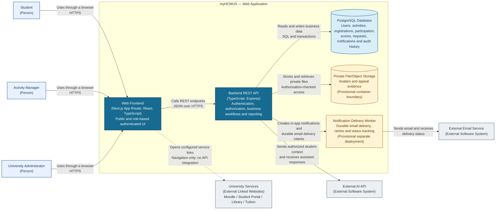

# Container Diagram

**Project:** myHCMUS — Extracurricular Activity and Training-Score Management System  
**Worker**: Trần Tôn Minh Kỳ  
**Reviewer**: Quách Thiên Lạc 

## 1. Purpose and Scope

The Container Diagram decomposes the myHCMUS software system from the System Context Diagram into its major runtime containers. It shows the web frontend, backend application, persistent data stores, notification processing, and external services needed to support the documented user workflows.

This diagram is a logical architecture view. It does not prescribe a final hosting topology. In particular, private file storage and the notification delivery worker are shown as provisional container boundaries because the requirements define their responsibilities but do not confirm whether they will be independently deployed or hosted as part of the backend runtime.

The diagram is based on the documented Next.js frontend architecture, Express/TypeScript backend stack, PostgreSQL database, business requirements, and system context. It does not represent the Figma prototype or mock services as production runtime containers.

## 2. Level 2 — Container Diagram

Solid arrows represent direct runtime communication or user interaction. The dashed arrow to University Services represents browser navigation to configured hyperlinks, not an API or database integration. Blue boxes are confirmed application containers. Yellow boxes are provisional container boundaries whose responsibilities are required but whose independent deployment is not yet confirmed.

## 3. Container Descriptions

### 3.1 Web Frontend

**Technology:** Next.js App Router, React 19, TypeScript, Tailwind CSS v4  
**Responsibility:** Provides the public landing page, authentication screens, role-based dashboards, activity discovery, registration, calendar, requests, score views, notifications, reports, and the University Services Hub.

The frontend organizes public and protected routes, maintains session-aware UI state, applies route-level authorization checks, and communicates with the backend through a centralized API client. It may use mock service implementations during development, but those mocks are not a production container.

### 3.2 Backend REST API

**Technology:** TypeScript, Express  
**Responsibility:** Provides the server-side application boundary for all protected operations and business workflows.

The backend is responsible for authentication and sessions, server-side role and resource-scope authorization, activity and registration management, waiting-list promotion, attendance and participation verification, training-score calculation and adjustment, appeals and recognition requests, dashboards, reports, imports, exports, audit logging, and notification creation. It also coordinates calls to the AI API and private file storage.

Business transactions such as registration, cancellation, waiting-list promotion, and request resolution must be atomic. Failures in email or AI services must not roll back already committed business changes.

### 3.3 PostgreSQL Database

**Responsibility:** Stores the durable business data required by the platform.

The database contains user accounts and roles, permissions and organizational scope, activities and schedules, eligibility, registrations and waiting-list state, attendance, verified participation, scoring policy versions, training scores and adjustments, requests and assignments, announcements, in-app notifications, delivery state, service links, and protected audit history.

The database preserves historical records and scoring policy versions so that later configuration changes do not rewrite prior results.

### 3.4 Private File/Object Storage

**Responsibility:** Stores uploaded avatars and recognition or appeal evidence outside the relational business records.

The backend validates file type and size before storing files and controls access so that evidence is visible only to the submitting student and authorized staff. The documentation does not identify a final provider or storage technology; therefore, this is a provisional container boundary.

### 3.5 Notification Delivery Worker

**Responsibility:** Delivers email notifications independently from the transaction that created the related business event.

The worker processes durable notification-delivery intents, retries failed attempts, records delivery status and errors, and prevents email failure from reversing registrations, request decisions, or score changes. The worker may be implemented as a separately deployed process, scheduled job, or backend module; the final topology is not specified.

## 4. Relationship Notes

- Students, Activity Managers, and University Administrators access the system through supported web browsers.
- The frontend calls the backend through a centralized REST API client rather than accessing the database directly.
- The backend is the only container responsible for enforcing server-side authorization and resource ownership or assignment scope.
- PostgreSQL is the system of record for durable business entities and audit history.
- File storage is accessed through the backend; clients do not receive unrestricted public access to evidence files.
- Notifications are persisted in-app, while email delivery is tracked separately so external email failure does not affect the original business transaction.
- The AI Student Assistant is advisory and must use only information the requesting student is authorized to access. It must not directly modify registrations, participation records, or scores.
- University Services are link destinations only. myHCMUS does not synchronize accounts, transactions, or official university database records with them.

## 5. Architecture Assumptions and Open Decisions

The following decisions remain open in the source documentation and should be resolved before treating this as a deployment diagram:

1. Whether the notification worker is independently deployed or remains inside the backend process.
2. Which provider and access mechanism will be used for private file/object storage.
3. Whether Vercel hosts only the frontend or participates in the final full-stack deployment.
4. Whether the external AI provider is permanently Google Gemini or remains provider-neutral.
5. Whether the documented role model uses one role per account or independently assigned roles through `UserRole`.

These decisions do not change the logical Level 2 relationships shown above, but they may change deployment boundaries and technology labels in a later deployment diagram.