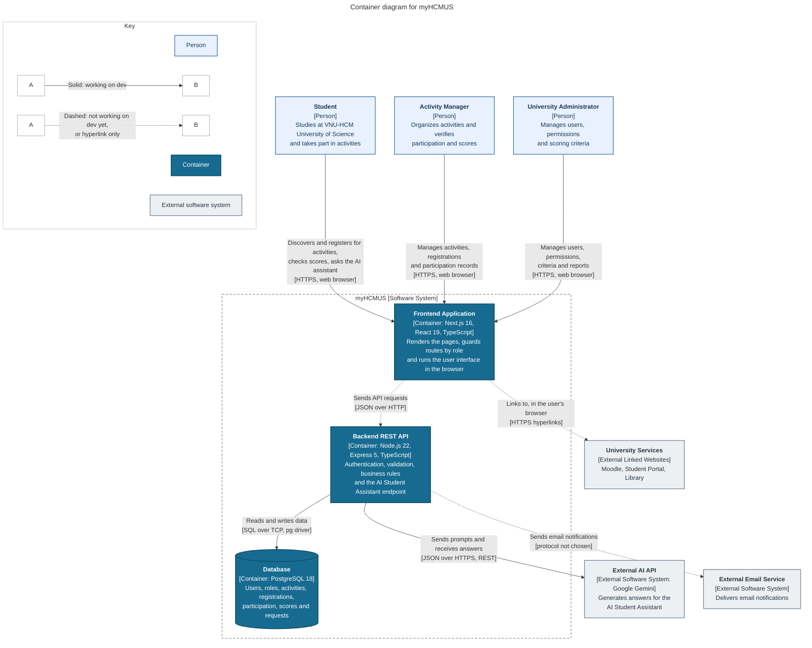

# Software Architecture: Container Diagram (C4 Level 2)
**Workers:** Phan Minh Khôi  
**Reviewers:**  
**Editors:**

**Version:** 0.2.0 (draft)  
**Amendment:** 2026/11/26

## 1. Purpose and scope

This document zooms into the myHCMUS software system from the [System Context Diagram](system-context-diagram.md) (C4 Level 1) and shows its containers, the technology of each one, and how they communicate. It belongs to PA4 section C (C4 Model, Level 2). The internal structure of the frontend container is described in the [Frontend Component Diagram](../fe/component-diagram-fe.md) (C4 Level 3), and the technologies are listed in [tech-stack.md](tech-stack.md).

In the C4 Model a *container* is an application or a data store that must be running for the system to work, such as a web application, an API server or a database. It is not a Docker container, although two of our containers do run in Docker.

The diagram reflects the `dev` branch at commit `1b1081a` (2026/11/24). The people and external systems use the same names as the System Context Diagram.

## 2. Container diagram

**Key.** Light blue boxes are people, dark blue boxes are containers of myHCMUS, and grey boxes are external software systems. The dashed border is the boundary of myHCMUS. Each arrow points in the direction of the request and is labelled with its purpose and, in brackets, its technology or protocol. A solid arrow is a connection that works on `dev`. A dashed arrow is either not working on `dev` yet (see [section 5](#5-current-state-of-the-connections)) or, for University Services, a plain hyperlink with no data exchange, as in the System Context Diagram.

## 3. Explanation of the diagram

Students, Activity Managers and University Administrators reach myHCMUS through a web browser and only ever talk to the **Frontend Application**. The Frontend Application shows the pages and decides which pages each role may open. When a page needs data or changes data, it calls the **Backend REST API**, which holds the business rules. The Backend REST API is the only container that talks to the **Database**, so every read and write passes through the same validation and access checks.

The three external systems are the same as in the System Context Diagram. The Backend REST API sends the questions of the AI Student Assistant to the **External AI API** (Google Gemini) and returns the answers. It will use an **External Email Service** to deliver email notifications. **University Services** such as Moodle and the Student Portal are only linked to from the pages: myHCMUS exchanges no data with them.

**Why the frontend is one container.** The C4 Model notes that an application that sends a large amount of JavaScript to the browser can be drawn as two containers: the server part and the part that runs in the browser. Next.js does both. We draw it as one container because both parts are built and deployed together from `src/client` as one Next.js application, and the [Frontend Component Diagram](../fe/component-diagram-fe.md) describes it as a single container. Section 4.1 explains which parts run on the server and which run in the browser.

## 4. Containers

### 4.1 Frontend Application

| | |
|---|---|
| **Responsibility** | Presents the user interface and controls which pages a user may open. |
| **Technology** | Next.js 16 (App Router) with React 19 and TypeScript, styled with Tailwind CSS 4. |
| **Source code** | `src/client` |
| **Runs on** | A Node.js process started with `npm run dev` (Next.js default port `3000`). The React code it sends runs in the user's web browser. It is not part of `docker-compose.yml`. |

**Services it provides**

- The public pages: the landing page (`/`) and the login page (`/login`).
- The protected pages for each role: `/student/dashboard`, `/manager/dashboard` and `/admin/dashboard`.
- Route protection on the Next.js server. `proxy.ts` runs before every page request, reads the frontend's `session` cookie, redirects visitors without a valid session to `/login`, and redirects a role that is not allowed on the requested path.
- Form validation in the browser (React Hook Form with Zod) before any request is sent.

**What runs where.** Page rendering, `proxy.ts` and the Route Handler `src/app/api/auth/login/route.ts` run on the Next.js server. The React components, forms and the API client run in the browser.

**Communication with other containers**

- **Users to Frontend Application:** HTTP requests from the web browser. In development this is plain HTTP on `localhost:3000`. In a deployed environment it must be HTTPS.
- **Frontend Application to Backend REST API:** JSON over HTTP. Every call is meant to go through one wrapper, `src/client/src/libs/api-client.ts`, which uses the Fetch API and reads the address of the backend from `NEXT_PUBLIC_API_BASE_URL`. This connection is not working on `dev` yet (section 5).
- **Frontend Application to Database:** none. The frontend never connects to the database.

### 4.2 Backend REST API

| | |
|---|---|
| **Responsibility** | Exposes the REST API of myHCMUS, applies validation and business rules, calls the External AI API, and is the only container that reads and writes the database. |
| **Technology** | Node.js 22 with Express 5 and TypeScript. |
| **Source code** | `src/server` |
| **Runs on** | The Docker container `myHCMUS-server`, built from `src/server/Dockerfile`. It listens on `BACKEND_PORT` (`8080` in the Dockerfile), which Docker Compose publishes to the host. |

**Services it provides**

| Endpoint | Access | Purpose |
|---|---|---|
| `POST /api/auth/register` | Public | Creates a student account. The password is stored as a bcrypt hash. |
| `POST /api/auth/login` | Public | Checks the email and password and returns a JWT access token that is valid for 1 hour. |
| `POST /api/ai/prompt` | Access token required, 10 requests per minute per user | Sends a student's question and the earlier turns of the conversation to the External AI API and returns the answer (UC-06). |
| `GET /health` | Public | Reports whether the server is healthy. |
| `GET /` | Public | Confirms the server is running. |

All responses use one JSON format (`ServiceResponse`: `success`, `statusCode`, `payload`). Requests pass through shared middleware that checks the HTTP method, the `Content-Type` header and, on `/api/ai/prompt`, the `Authorization: Bearer` access token and the rate limit.

**Communication with other containers and systems**

- **Frontend Application to Backend REST API:** JSON over HTTP on port `8080`.
- **Backend REST API to Database:** SQL over a TCP connection on port `5432`, using the PostgreSQL protocol through the `pg` driver and a connection pool (`src/server/src/connections/db.ts`). Inside the Docker Compose network the server reaches the database by the host name `db`.
- **Backend REST API to External AI API:** JSON over HTTPS to Google's Generative Language REST API (`generativelanguage.googleapis.com`), authenticated with an API key in the `x-goog-api-key` header, with a 20-second timeout (`src/server/src/clients/GeminiClient.ts`). If the AI service fails, only `/api/ai/prompt` returns an error and the other endpoints keep working.

### 4.3 Database

| | |
|---|---|
| **Responsibility** | Stores all persistent data of the system and protects its integrity with keys and `CHECK` constraints. |
| **Technology** | PostgreSQL 18. |
| **Source code** | `src/db/schema.sql` (45 tables) |
| **Runs on** | The Docker container `myHCMUS-db` (image `postgres:18`), port `5432`. The data is kept in the Docker volume `myHCMUS-db`. |

**Services it provides**

- Storage and querying of users and roles, organizations, activities, registrations, participation and attendance, training scores, recognition requests and appeals, notifications, service links, and the audit log.
- Transactions. For example, registering a user inserts into `User` and `UserRole` in one transaction, so a failure leaves no partial account.

**Communication with other containers**

- It accepts connections only from the Backend REST API, over TCP on port `5432`. It never starts a connection itself.
- Docker Compose checks its health every 5 seconds with `pg_isready`.

### 4.4 External systems

These are outside the system boundary and are not containers of myHCMUS. Their names match the System Context Diagram.

| External system | Used by | Protocol | Purpose |
|---|---|---|---|
| External AI API (Google Gemini) | Backend REST API | JSON over HTTPS | Generates answers for UC-06 "Chat with AI Student Assistant". |
| External Email Service | Backend REST API | Not chosen yet | Will deliver email notifications for UC-17 "Receive activity notifications". |
| University Services | The user's browser | HTTPS hyperlinks | UC-07 "Access university services". myHCMUS only shows links and exchanges no data. |

## 5. Current state of the connections

PA4 requires the diagrams to match the code. This table states which connections work on `dev`, so the dashed arrows are not read as finished work.

| Connection | State on `dev` | Evidence |
|---|---|---|
| People to Frontend Application | Working. | `src/client/src/app` |
| Backend REST API to Database | Working for registration and login. | `src/server/src/repositories/AuthRepository.ts` |
| Backend REST API to External AI API | Working. | `src/server/src/clients/GeminiClient.ts`, `src/server/src/routes/AIRoute.ts` |
| Frontend Application to Backend REST API | Not working yet. The real services exist (`auth.service.ts`, `activity.service.ts`), but `AuthProvider` uses `mockAuthService`, activities use mock data unless `NEXT_PUBLIC_DATA_SOURCE=api`, and the paths do not match the backend (section 6). | `src/client/src/features/auth/provider/AuthProvider.tsx`, `src/client/src/libs/service-mode.ts` |
| Backend REST API to External Email Service | Not started. The database models email delivery (`NotificationDelivery`), but no code sends email. | none |
| Frontend Application to University Services | Hyperlinks only, by design. The links are defined, but the service cards on the landing page are currently always shown locked and display-only, so no link can be opened yet. | `src/client/src/features/landing/config/services.ts` |

**Update rule:** when one of these connections starts working, change its arrow from dashed (`-.->`) to solid (`-->`) and update this table in the same pull request.

## 6. Issues found while drawing the diagram

These points must be fixed in code before the Frontend Application can really call the Backend REST API.

1. **Different default address.** `api-client.ts` falls back to `http://localhost:3000`, which is the frontend itself. The backend listens on port `8080`.
2. **Different paths.** The frontend services call `/auth/login`, `/auth/logout`, `/auth/me` and `/activities/landing`. The backend exposes `/api/auth/login` and has no logout, current-user or activity endpoints.
3. **No CORS setting.** The backend does not send CORS headers, so a page served from port `3000` cannot call port `8080` directly from the browser.
4. **The two tokens are not linked.** The frontend signs its own `session` cookie with `SESSION_SECRET`, and the backend signs an access token with `JWT_SECRET`. `api-client.ts` never sends an `Authorization` header, so the frontend cannot use `/api/ai/prompt` yet.
5. **The health check does not test the database.** The database query in `databaseCheckHelper.ts` is commented out, so `/health` reports the database as up without contacting it.
6. **The frontend is not in Docker Compose.** It is started separately with `npm run dev`. This matters for the deployment diagram.
