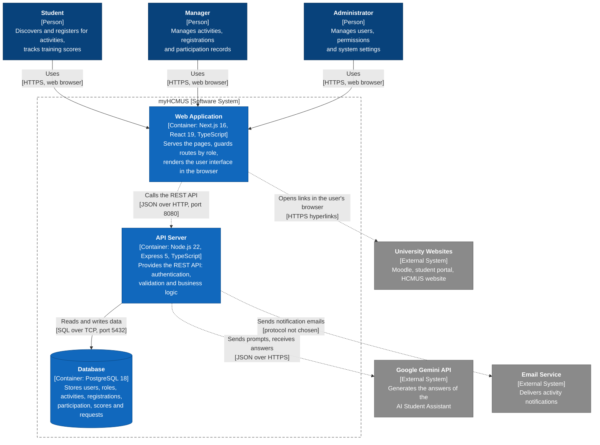

# Software Architecture: Container Diagram (C4 Level 2)
**Workers:** Phan Minh Khôi  
**Reviewers:**  
**Editors:**

**Version:** 0.1.0 (draft)  
**Amendment:** 2026/11/17

## 1. Purpose and scope

This document zooms into the myHCMUS system and shows its containers, the technology of each container, and how the containers communicate. It belongs to PA4 section C (C4 Model, Level 2). In the C4 Model a *container* is a separately running part of the system, such as a web application, an API server or a database. It is not the same thing as a Docker container, although two of our containers do run in Docker.

The diagram reflects the `dev` branch (commit `f2ca6f3`, 2026/11/17). The technologies named here are described in [tech-stack.md](tech-stack.md).

## 2. Container diagram

Solid arrows are connections that work on `dev` today. Dashed arrows are connections that exist in the code or in the product vision but are not active on `dev` yet. [Section 5](#5-current-state-of-the-connections) explains each dashed arrow.

## 3. Explanation of the diagram

Three kinds of users reach myHCMUS through a web browser: students, managers and administrators. They only ever talk to the **Web Application**. The Web Application shows the pages and decides which pages each role may open. When a page needs data or changes data, the Web Application calls the **API Server**, which holds the business rules. The API Server is the only container that talks to the **Database**, so every read and write passes through the same validation and access checks.

Outside the system boundary there are three external systems. The **Google Gemini API** produces the answers of the AI Student Assistant. An **Email Service** will deliver notifications. **University Websites** such as Moodle and the student portal are only linked to: myHCMUS does not exchange data with them, which matches the Vision Document (section 4.1).

## 4. Containers

### 4.1 Web Application

| | |
|---|---|
| **Responsibility** | Presents the user interface and controls which pages a user may open. |
| **Technology** | Next.js 16 (App Router) with React 19 and TypeScript, styled with Tailwind CSS 4. |
| **Source code** | `src/client` |
| **Runs on** | A Node.js process started with `npm run dev` (port `3000`). The pages it produces run in the user's web browser. It is not part of `docker-compose.yml` yet. |

**Services it provides**

- The public pages: the landing page (`/`) and the login page (`/login`).
- The protected pages for each role: `/student/dashboard`, `/manager/dashboard` and `/admin/dashboard`.
- Route protection. `proxy.ts` runs before every page request, reads the `session` cookie, redirects visitors without a valid session to `/login`, and rejects a role that is not allowed on the requested path.
- Form validation in the browser (React Hook Form with Zod) before any request is sent.

**Communication with other containers**

- **Users to Web Application:** HTTP requests from the web browser. In development this is plain HTTP on `localhost:3000`. In a deployed environment it must be HTTPS.
- **Web Application to API Server:** JSON over HTTP. Every call goes through one wrapper, `src/client/src/libs/api-client.ts`, which uses the Fetch API and reads the address of the API Server from `NEXT_PUBLIC_API_BASE_URL`.
- **Web Application to Database:** none. The Web Application never connects to the database.

### 4.2 API Server

| | |
|---|---|
| **Responsibility** | Exposes the REST API of myHCMUS, applies validation and business rules, and is the only container that reads and writes the database. |
| **Technology** | Node.js 22 with Express 5 and TypeScript. |
| **Source code** | `src/server` |
| **Runs on** | The Docker container `myHCMUS-server`, built from `src/server/Dockerfile`, port `8080`. |

**Services it provides**

| Endpoint | Purpose |
|---|---|
| `POST /api/auth/register` | Creates a student account. The password is stored as a bcrypt hash. |
| `POST /api/auth/login` | Checks the email and password and returns a JWT access token that is valid for 1 hour. |
| `GET /health` | Reports whether the server is healthy. |
| `GET /` | Root endpoint that confirms the server is running. |

All responses use one JSON format (`ServiceResponse`: `success`, `statusCode`, `payload`). Requests pass through shared middleware that checks the HTTP method and the `Content-Type` header. A third check for the `Authorization: Bearer` token (`validateAccessToken`) is written, but no route on `dev` uses it yet because the two existing endpoints are public.

**Communication with other containers**

- **Web Application to API Server:** JSON over HTTP on port `8080` (published to the host by Docker Compose).
- **API Server to Database:** SQL sent over a TCP connection on port `5432`, using the PostgreSQL protocol through the `pg` driver and a connection pool (`src/server/src/connections/db.ts`). Inside the Docker Compose network the server reaches the database by the host name `db`.
- **API Server to Google Gemini API:** JSON over HTTPS, authenticated with an API key. Not on `dev` yet.

### 4.3 Database

| | |
|---|---|
| **Responsibility** | Stores all persistent data of the system and protects its integrity with keys and `CHECK` constraints. |
| **Technology** | PostgreSQL 18. |
| **Source code** | `src/db/schema.sql` (45 tables) |
| **Runs on** | The Docker container `myHCMUS-db` (image `postgres:18`), port `5432`. The data is kept in the Docker volume `myHCMUS-db`. |

**Services it provides**

- Storage and querying of users and roles, organizations, activities, registrations, participation and attendance, training scores, recognition requests and appeals, notifications, service links, and the audit log.
- Transactions. For example, registering a user inserts into `User` and `UserRole` in one transaction, so a failure leaves no partial account.

**Communication with other containers**

- It accepts connections only from the API Server, over TCP on port `5432`. It never starts a connection itself.
- Docker Compose checks its health every 5 seconds with `pg_isready`.

### 4.4 External systems

These are outside the system boundary and are not containers of myHCMUS. They are listed so the diagram is complete.

| External system | Used by | Protocol | Purpose |
|---|---|---|---|
| Google Gemini API | API Server | JSON over HTTPS | Generates answers for UC-06 "Chat with AI Student Assistant". |
| Email Service | API Server | Not chosen yet | Delivers notifications for UC-17 "Receive activity notifications". |
| University Websites | The user's browser | HTTPS hyperlinks | UC-07 "Access university services". myHCMUS only shows links and exchanges no data. |

## 5. Current state of the connections

PA4 requires the diagram to match the code. This table states honestly which connections work on `dev` today, so the dashed arrows are not read as finished work.

| Connection | State on `dev` | Evidence |
|---|---|---|
| Users to Web Application | Working. | `src/client/src/app` |
| API Server to Database | Working for registration and login. | `src/server/src/repositories/AuthRepository.ts` |
| Web Application to API Server | Written but not switched on. The real services exist (`auth.service.ts`, `activity.service.ts`), but `AuthProvider` uses `mockAuthService`, and activities use mock data unless `NEXT_PUBLIC_DATA_SOURCE=api`. | `src/client/src/features/auth/provider/AuthProvider.tsx`, `src/client/src/libs/service-mode.ts` |
| API Server to Google Gemini API | Implemented on the branch `feat/backend/implement-ai-endpoint`, not merged into `dev`. | `src/server/src/clients/GeminiClient.ts` on that branch |
| API Server to Email Service | Not started. | none |
| Web Application to University Websites | Links are defined, but the service cards on the landing page are currently display-only. | `src/client/src/features/landing/config/services.ts` |

**Update rule:** when one of these connections is switched on, change its arrow from dashed (`-.->`) to solid (`-->`) and update this table in the same pull request.

## 6. Issues found while drawing the diagram

These points must be fixed in code before the Web Application can really call the API Server. They are listed here so the team can turn them into tasks.

1. **Different default address.** `api-client.ts` falls back to `http://localhost:3000`, which is the Web Application itself. The API Server listens on port `8080`.
2. **Different path prefix.** The frontend services call `/auth/login` and `/activities/landing`, but the API Server exposes `/api/auth/login`. The base address must therefore end with `/api`, or the paths must be changed.
3. **No CORS setting.** The API Server does not send CORS headers, so a browser page served from port `3000` cannot call port `8080` directly.
4. **Two separate tokens.** The Web Application signs its own `session` cookie with `SESSION_SECRET`, and the API Server signs an access token with `JWT_SECRET`. The team needs to decide how the two are linked after a real login.
5. **The health check does not test the database.** The database query in `databaseCheckHelper.ts` is commented out, so `/health` reports the database as up without contacting it.
6. **The Web Application is not in Docker Compose.** It is started separately with `npm run dev`. This matters for the deployment diagram.
