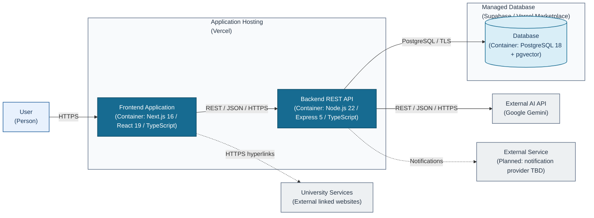

# myHCMUS Deployment Diagram

**Worker:** Quách Thiên Lạc  
**Reviewer(s):** Phạm Vân Trang  
**Editor(s):** Quách Thiên Lạc

**Version:** 2.0.0  
**Amendment:** 28/11/2026

---

## Deployment Diagram

The diagram shows the target Vercel deployment for myHCMUS. Users access the Next.js application over HTTPS. Vercel hosts the frontend and the Express backend API within the application hosting boundary. The backend is packaged as a Docker/OCI container and deployed through Vercel Functions; API requests use REST with JSON over HTTPS. Vercel routes requests to the container's internal HTTP port **8080** through its `PORT` environment variable.

The API connects to the provider-managed PostgreSQL database over TLS through a pooled endpoint. The database is provisioned through a Vercel Marketplace integration, with its connection string supplied to the API through environment variables. Docker Compose and its database volume remain part of local development.

The backend calls Google Gemini through its REST API for AI assistant requests. The notification service is shown as planned, with its provider still to be selected. University Services are reached through HTTPS hyperlinks only; they are not direct API or database integrations.
