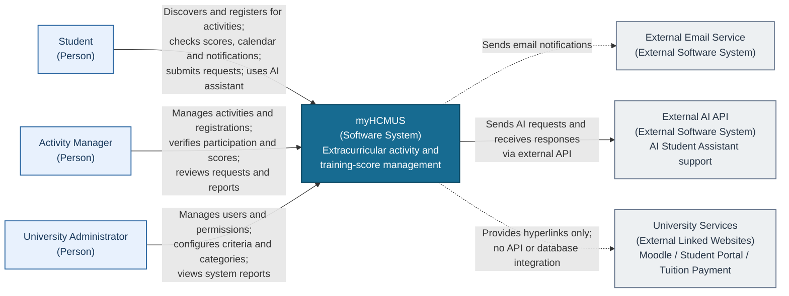

# System Context Diagram

**Project:** myHCMUS — Extracurricular Activity and Training-Score Management System  
**Worker**: Phạm Vân Trang  
**Reviewer**: Quách Thiên Lạc 

## 1. Purpose and Scope

The System Context Diagram presents myHCMUS as a single software system, identifies the people who use it, and shows relevant external systems and their relationships with myHCMUS. The diagram describes the system boundary rather than the internal frontend, backend, database, or deployment structure. 

myHCMUS is a standalone web-based platform for students, activity managers, and university administrators at VNU-HCM University of Science. It centralizes activity discovery and registration, activity organization, participation and training-score management, calendars, notifications, student requests and appeals, reporting, and AI-assisted support.

## 2. System Context Diagram

**Diagram legend:** Solid arrows show direct user interactions or external service dependencies. Dashed arrows represent navigation-only hyperlinks or relationships that are planned but not yet implemented. The blue system box represents the entire myHCMUS application.

## 3. Explanation of the Diagram

At the center of the diagram, **myHCMUS** represents the complete application within the project boundary. The three types of users interact with this system through a web browser.

**Students** use myHCMUS to find and register for extracurricular activities, receive updates, monitor their participation and training-score results, organize their calendar, and submit recognition or appeal requests. The AI Student Assistant offers additional help with activity recommendations and information queries.

**Activity Managers** maintain activity information, coordinate registrations, record or verify participation and training-score results, resolve authorized student requests, and monitor activity performance. **University Administrators** manage user permissions, scoring criteria, categories, and system-wide reporting.

For outbound communication, myHCMUS uses an external Email Service to deliver email notifications in addition to in-app notifications. The AI Student Assistant communicates with a external AI API: myHCMUS sends AI requests and receives generated results for questions and activity recommendations. The external provider hosts the AI capability; the application remains responsible for using its own activity and user data as appropriate. The University Services Hub provides links to existing university websites; these links do not imply direct integration with official university systems.

