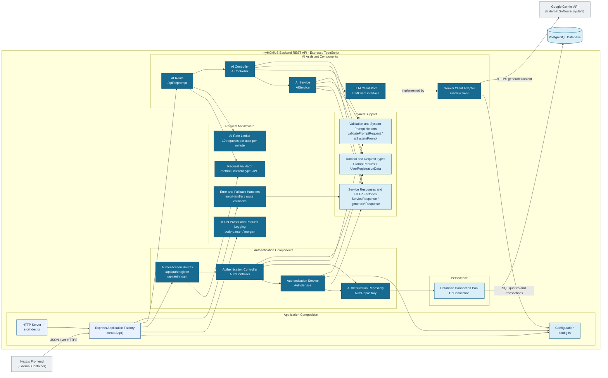

# Backend Component Architecture

**Project:** myHCMUS  
**Container:** Backend REST API  
**Architecture Model:** C4 Model - Level 3 (Component Diagram)  
**Technology:** Node.js, Express 5, TypeScript, PostgreSQL, Gemini REST API  
**Last Updated:** November 25, 2026

---

## 1. Overview

This document describes the internal architecture of the myHCMUS Backend REST API using the Component Diagram from the C4 Model.

The backend is implemented as a modular monolith. Express composes the application and delegates requests to route modules. Route modules apply middleware and invoke controllers. Controllers translate HTTP requests and responses, while services contain business logic and repositories or clients handle external resources.

The currently implemented backend components are:

- **Application Composition:** Builds the Express application, registers routes, and starts the HTTP server.
- **Request Middleware:** Parses requests, validates methods and content types, verifies access tokens, limits AI requests, and handles errors.
- **Authentication API:** Exposes registration and login endpoints.
- **Authentication Controller:** Validates authentication input and maps service results to HTTP responses.
- **Authentication Service:** Hashes passwords, verifies credentials, creates JWT sessions, and coordinates authentication persistence.
- **Authentication Repository:** Reads and writes user, role, and role-specific records in PostgreSQL.
- **AI API:** Exposes the authenticated student-assistant prompt endpoint.
- **AI Controller:** Validates prompt payloads and maps AI service results to HTTP responses.
- **AI Service:** Applies assistant business rules, conversation shaping, safety responses, and failure handling.
- **LLM Client:** Hides the provider-specific Gemini HTTP protocol behind the `LLMClient` interface.
- **Database Connection:** Owns the PostgreSQL connection pool used by repositories.
- **Shared Response and Validation Support:** Provides request types, response objects, validation helpers, and HTTP error response factories.

The diagram reflects the source code in `src/server/src`. Some platform capabilities described in the container and business documentation, such as activities, registrations, notifications, and reporting, do not yet have backend components in the current implementation and are therefore not shown as implemented components here.

## 2. Level 3 - Backend Component Diagram

The following diagram illustrates the internal components of the Backend REST API and its dependencies on PostgreSQL, the frontend client, and the external Gemini API.

Solid arrows represent direct runtime dependencies. The dashed arrow identifies the `LLMClient` abstraction and its `GeminiClient` implementation. The frontend and Gemini API are outside the backend container; PostgreSQL is an external data store from the backend's component perspective.

## 3. Relationship Notes

- `createApp()` is the composition root. It creates the AI client and service, registers both route modules, and installs global fallback handlers.
- `index.ts` starts the HTTP server by calling `createApp()` and owns graceful shutdown.
- Authentication routes validate HTTP method and content type before invoking the authentication controller.
- The AI route validates method, access token, and content type, then applies the in-memory per-user rate limiter before invoking the AI controller.
- Controllers own HTTP concerns. They validate endpoint-specific payloads, call services, and serialize `ServiceResponse` objects.
- Authentication currently uses `AuthRepository` directly in `AuthController` for duplicate checks and through `AuthService` for registration and login operations.
- `AuthService` hashes passwords with bcrypt, verifies credentials, and signs JWT access tokens using configured secrets.
- `AuthRepository` uses the shared PostgreSQL pool and wraps user registration inserts in a database transaction.
- `AIService` depends on the `LLMClient` interface rather than Gemini-specific code. This allows tests to inject a fake client and keeps provider details in `GeminiClient`.
- AI provider failures are converted to a generic `503` response. Quota failures additionally produce a `Retry-After` value.
- Shared response factories and validation helpers keep endpoint error shapes consistent.
- The backend is the authorization boundary for protected API operations. The frontend does not access PostgreSQL directly.

## 4. Component Descriptions

### 4.1 Application Composition

**Location:** `src/server/src/index.ts`, `src/server/src/app.ts`

**Responsibility:** Builds the Express application, configures global middleware, registers API routes, exposes health and root callbacks, and starts the HTTP listener.

`createApp()` accepts an optional `LLMClient` and quiet logging option so integration tests can replace the production Gemini adapter without changing application wiring.

### 4.2 Request Middleware

**Location:** `src/server/src/middleware/`

**Responsibility:** Provides cross-cutting HTTP behavior.

- `ValidatorMiddleware` checks allowed HTTP methods, exact JSON content type, and Bearer JWT access tokens.
- `RateLimitMiddleware` tracks prompt requests per authenticated user in a fixed in-memory window.
- `errorHandler` and route callbacks produce consistent responses for unexpected errors, missing routes, health checks, and the root endpoint.
- `body-parser` and `morgan` provide JSON parsing and optional request logging.

### 4.3 Authentication Components

**Location:** `src/server/src/routes/AuthRoute.ts`, `controllers/AuthController.ts`, `services/AuthService.ts`, `repositories/AuthRepository.ts`

**Responsibility:** Implements student registration and login.

The controller checks required input and coordinates duplicate email and phone checks. The service creates user identifiers, hashes passwords, persists new users, verifies login credentials, and returns signed JWT tokens. The repository executes PostgreSQL queries for users, roles, and role-specific records.

### 4.4 AI Assistant Components

**Location:** `src/server/src/routes/AIRoute.ts`, `controllers/AIController.ts`, `services/AIService.ts`, `clients/`

**Responsibility:** Provides the authenticated `/api/ai/prompt` endpoint.

The controller validates the prompt body and delegates to `AIService`. The service combines conversation history with the current message, applies the system prompt, converts blocked content to a safe response, and normalizes provider failures. `GeminiClient` is the provider adapter and is the only component that knows the Gemini URL, request format, and provider response format.

### 4.5 Shared Support

**Location:** `src/server/src/types/`, `src/server/src/helper/`

**Responsibility:** Defines request and domain shapes, response envelopes, endpoint validation, system prompts, and HTTP error response factories.

These components support the route, controller, and service layers but do not own transport, business orchestration, or persistence.

### 4.6 Persistence

**Location:** `src/server/src/connections/db.ts`

**Responsibility:** Creates the PostgreSQL `Pool` from environment-backed configuration and supplies connections to repositories.

The connection component is deliberately kept below the repository boundary. Controllers and services do not issue SQL directly.

## 5. Implementation Boundaries and Open Decisions

- The backend currently contains authentication and AI assistant components. The broader container diagram describes additional business capabilities that still need corresponding route, service, and repository modules.
- `RateLimitMiddleware` stores counters in process memory. It is suitable for the current phase but would need shared storage or a dedicated rate-limiting service for multiple backend instances.
- `AuthRepository` is named `InMemoryAuthRepository` in the source for historical reasons, but its current implementation uses PostgreSQL through `DbConnection`.
- The database connection module is wired into the authentication repository. Other business repositories have not yet been implemented in `src/server/src`.
- The Gemini provider is isolated behind `LLMClient`, so replacing the provider should not require changing controllers or `AIService`.
- The final deployment topology for the backend, PostgreSQL, file storage, and notification delivery remains a separate deployment-diagram concern.
