# myHCMUS Deployment Diagram

**Worker:** Quách Thiên Lạc  
**Reviewer(s):** Phạm Vân Trang 
**Editor(s):** Quách Thiên Lạc

**Version:** 1.0.0  
**Amendment:** 19/11/2026

---

The diagram shows the target Vercel deployment for myHCMUS. Users access the React and TypeScript interface through a web browser. Vercel hosts the Next.js application and serves pages and static assets over HTTPS.

The Express API is packaged as a Docker/OCI container and deployed on Vercel Functions using the container runtime. API requests follow **client → Next.js web application → backend API**. The client sends requests to the Next.js frontend over HTTPS, and Next.js forwards them to the Express backend using REST requests with JSON payloads over **HTTPS on port 443** (default port). Vercel routes these requests to the container's internal HTTP port **8080** (default port is **80** but can be explicitly set with Vercel's `PORT` environment variable).

The **API → database** connection uses the `pg` driver over **TLS** through a pooled PostgreSQL endpoint. The database is provisioned through a Vercel Marketplace integration, with its connection string supplied to the API through environment variables. The database provider manages persistent storage. Docker Compose and its database volume remain part of local development.

External services include email services accessed through providers such as Gmail or Outlook, which the application uses to send notifications to users, and AI services, which are accessed via an MCP client, to power the in-app chatbot (models are yet to be decided and will be chosen in the next sprint).

References: [Docker deployments on Vercel](https://vercel.com/kb/guide/does-vercel-support-docker-deployments), [Postgres on Vercel](https://vercel.com/docs/postgres), and [Marketplace storage integrations](https://vercel.com/docs/marketplace-storage).
