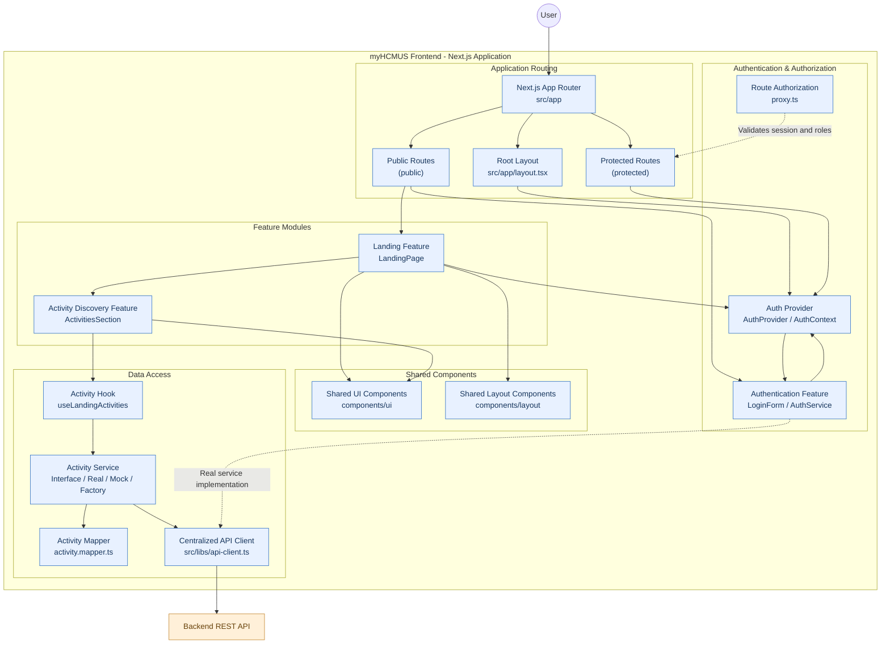
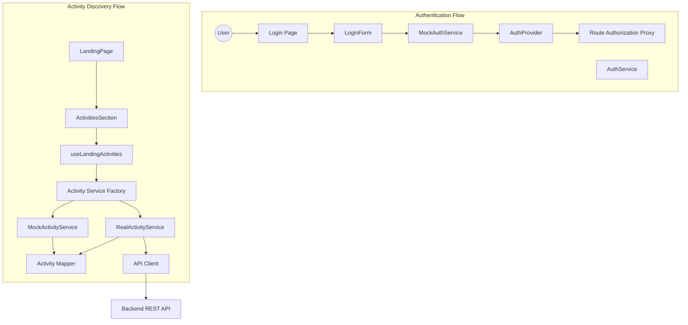

# Frontend Component Architecture

**Project:** myHCMUS  
**Container:** Next.js Frontend Application  
**Architecture Model:** C4 Model – Level 3 (Component Diagram)  
**Technology:** Next.js App Router, React 19, TypeScript, Tailwind CSS v4  
**Last Updated:** November 19, 2026

---

## 1. Overview

This document describes the internal architecture of the myHCMUS Frontend application using the Component Diagram from the C4 Model.

The Frontend is implemented as a single Next.js application following a feature-first architecture. Each business feature encapsulates its own components, hooks, services, types, and data mappers where needed.

The main architectural components are:

- **Application Routing:** Handles page routing, layouts, and route composition.
- **Authentication:** Handles user authentication and session state.
- **Landing Page:** Composes the public-facing homepage.
- **Activity Discovery:** Retrieves and displays featured activities.
- **Shared UI:** Provides reusable interface components and layouts.
- **API Client:** Centralizes HTTP communication with the Backend.
- **Route Authorization:** Protects restricted routes based on user sessions and roles.

The Frontend communicates with the Backend through a centralized API Client rather than making HTTP requests directly from UI components.

## 2. Level 3 – Frontend Component Diagram

The following diagram illustrates the internal components of the Next.js Frontend application and their dependencies.

**Relationship notes:**

- The App Router resolves incoming requests and renders the corresponding routes.
- The Root Layout provides the global application structure and authentication context.
- Public Routes and Protected Routes organize pages according to their access requirements.
- The Landing Feature composes the homepage using shared UI and layout components.
- The Activity Discovery Feature retrieves activity data through its service and hook.
- The Authentication Feature provides authentication operations and integrates with the Auth Provider.
- The API Client acts as the shared HTTP communication boundary between frontend services and the Backend.
- The Route Authorization component validates sessions and role-based access before allowing protected routes.

## 3. Component Descriptions

This section describes the responsibility and relationships of each component in the Level 3 diagram.

### 3.1. Application Routing

**Location:** `src/app/`

**Responsibility:**

The Application Routing component manages the application's routing structure using the Next.js App Router.

It organizes pages into route groups and provides the layouts required by different sections of the application.

**Main elements:**

- `RootLayout`: Defines the global application layout and providers.
- `PublicRoutes`: Contains publicly accessible pages, including the landing page and login page.
- `ProtectedRoutes`: Organizes authenticated pages that require session validation.

**Relationships:**

- Uses the Auth Provider through the Root Layout to expose authentication state.
- Renders the Landing Feature for the public homepage.
- Renders the Authentication Feature for login-related pages.
- Works with Route Authorization to restrict access to protected routes.

### 3.2. Authentication Feature

**Location:** `src/features/auth/`

**Responsibility:**

The Authentication Feature handles user authentication and related account operations.

It provides the functionality required for users to log in, log out, recover passwords, reset passwords, change passwords, and retrieve their current user information.

**Main elements:**

- `LoginForm`: Collects and validates user credentials.
- `AuthService`: Implements authentication requests through the API Client.
- `MockAuthService`: Provides mock authentication responses for development.
- Authentication types and DTOs: Define authentication request and response structures.

**Relationships:**

- Receives user input through the Login Form.
- Provides authentication operations to the Auth Provider.
- Uses the API Client through the real Auth Service implementation.
- Uses mock responses through MockAuthService during development.

**Implementation note:**

The existing Auth Provider currently uses `mockAuthService` directly. The real `AuthService` exists separately and is not yet selected through a shared service interface and factory. Therefore, the diagram distinguishes the real API dependency from the active mock implementation.

### 3.3. Auth Provider

**Location:** `src/` (AuthProvider and `hooks/useAuth.ts`)

**Responsibility:**

The Auth Provider manages and exposes authentication state throughout the React application.

It allows components to access the current user's session information and authentication status without implementing authentication logic independently.

**Main elements:**

- `AuthProvider`: Provides authentication context.
- `AuthContext`: Stores shared authentication state.
- `useAuth`: Provides a hook for consuming authentication context.

**Relationships:**

- Wraps the application through the Root Layout.
- Communicates with the Authentication Feature to perform authentication operations.
- Provides authentication information to the Landing Feature and other consumers.
- Supplies the authentication state used by UI components to determine appropriate actions.

### 3.4. Route Authorization

**Location:** `proxy.ts`

**Responsibility:**

The Route Authorization component protects restricted application routes.

It checks the user's session cookie, decrypts session information, and evaluates role-based access rules before allowing navigation.

**Main elements:**

- Session validation through `src/libs/session.ts`.
- Role definitions and access rules through `src/libs/roles.ts`.
- Navigation configuration through `src/libs/navigation.ts`.

**Relationships:**

- Intercepts incoming navigation requests.
- Reads session information from request cookies.
- Uses role rules to determine whether the current user can access a route.
- Redirects unauthenticated users to the login page.
- Redirects users without the required role to the forbidden page.

### 3.5. Landing Feature

**Location:** `src/features/landing/`

**Responsibility:**

The Landing Feature composes the public homepage and presents information about the myHCMUS platform.

It organizes the homepage into reusable sections and delegates interactive or data-driven functionality to the appropriate feature modules.

**Main elements:**

- `LandingPage`: Main composition component.
- `HeroSection`: Introduces the platform.
- `HighlightsSection`: Presents platform highlights.
- `ActivitiesSection`: Displays featured activities.
- `ServicesSection`: Presents available university services.
- `HelpSection`: Provides guidance and help information.

**Relationships:**

- Is rendered by the public homepage route.
- Uses Shared UI Components for reusable visual elements.
- Uses Shared Layout Components for site navigation and footer.
- Consumes authentication state through `useAuth`.
- Integrates with the Activity Discovery Feature to display featured activities.

### 3.6. Activity Discovery Feature

**Location:** `src/features/activities/`

**Responsibility:**

The Activity Discovery Feature retrieves and presents activity information on the public landing page.

It separates data retrieval, transformation, and presentation to keep UI components independent of backend communication details.

**Main elements:**

- `ActivitiesSection`: Main activity presentation component.
- `ActivityGrid`: Displays activities in a grid layout.
- `ActivityCard`: Presents individual activity information.
- `ActivitiesSkeleton`: Displays the loading state.
- `useLandingActivities`: Handles activity retrieval and UI data states.
- `ActivityService`: Defines the activity data service contract.
- `RealActivityService`: Retrieves data through the API Client.
- `MockActivityService`: Provides mock activity data.
- `activity.service.factory.ts`: Selects the appropriate service implementation.
- `activity.mapper.ts`: Converts API DTOs into domain models.

**Relationships:**

- Is consumed by the Landing Feature.
- Uses `useLandingActivities` to retrieve and manage activity data.
- Uses ActivityService to access activity information.
- Uses Activity Mapper to transform transport data into domain models.
- Uses the API Client through the real service implementation.
- Uses Shared UI Components to render activity cards and data states.

### 3.7. Shared UI Components

**Location:** `src/components/ui/`

**Responsibility:**

The Shared UI Components provide reusable, generic interface primitives used throughout the application.

They ensure visual consistency and reduce duplicated UI implementation across different features.

**Examples:**

- `Button`
- `Container`
- `Section`
- `SectionHeader`
- `Badge`
- `Tag`
- `Skeleton`
- `EmptyState`
- `ErrorState`
- `SurfaceCard`

**Relationships:**

- Used by the Landing Feature and Activity Discovery Feature.
- Provides reusable presentation elements without owning business logic.
- Uses design tokens defined in `src/app/globals.css`.

### 3.8. Shared Layout Components

**Location:** `src/components/layout/`

**Responsibility:**

The Shared Layout Components provide common structural elements that define the overall appearance and navigation of the application.

**Examples:**

- `SiteHeader`
- `SiteFooter`
- `Logo`
- `CopyrightYear`

**Relationships:**

- Used by the Landing Feature to construct the homepage layout.
- Receives navigation and footer configuration through props.
- Uses shared types and navigation configuration.

### 3.9. Activity Service and Data Mapping

**Location:** `src/features/activities/services/` and `src/features/activities/mappers/`

**Responsibility:**

This component group manages the boundary between activity data retrieval and the application's domain model.

The service contract defines the operations required by the Activity Discovery Feature, while its implementations determine where the data originates.

**Main elements:**

- `ActivityService`: Defines the service contract.
- `RealActivityService`: Communicates with the Backend through the API Client.
- `MockActivityService`: Returns predefined activity fixtures.
- `activity.service.factory.ts`: Selects the service implementation.
- `activity.mapper.ts`: Converts API DTOs into application domain models.

**Relationships:**

- Is consumed by `useLandingActivities`.
- Uses the API Client when the real implementation is selected.
- Uses mock fixtures when the mock implementation is selected.
- Uses the Activity Mapper to convert API responses into domain models.

### 3.10. Centralized API Client

**Location:** `src/libs/api-client.ts`

**Responsibility:**

The API Client centralizes HTTP communication between the Frontend and Backend.

It provides a consistent interface for sending requests, managing headers, serializing request data, resolving the API base URL, and normalizing errors.

**Relationships:**

- Is consumed by feature service implementations.
- Communicates with the Backend REST API.
- Provides a shared communication boundary for the Frontend.
- Prevents individual UI components from implementing their own HTTP communication.

## 4. Main Component Interaction Flow

The following diagram illustrates two important interactions within the current implementation: authentication and activity discovery.

**Interaction summary:**

1. A user accesses the login page and submits credentials through the Login Form.
2. The Authentication Feature processes the request through the currently configured mock authentication service.
3. The Auth Provider exposes authentication state to the rest of the application.
4. Route Authorization validates session information and role-based access for protected routes.
5. The Landing Page renders the Activity Discovery section.
6. The activity hook requests data through the Activity Service Factory.
7. The factory selects the mock or real service implementation.
8. The real service communicates with the Backend through the API Client.
9. Activity data is mapped into domain models before being presented by the UI.

## 5. Architectural Boundaries and Exclusions

The following elements are intentionally excluded from this Level 3 diagram.

| Element | Reason for exclusion |
|---|---|
| Individual buttons and input fields | Low-level UI elements rather than architectural components |
| React state variables | Internal implementation details |
| Individual CSS files | Styling implementation, not architectural components |
| Database tables | Belong to the Backend container |
| Backend controllers and services | Outside the scope of the Frontend container |
| Profile Management internal components | Must be documented after their implementation is confirmed |
| University Services Hub internal components | Must be documented after their implementation is confirmed |
| System Administration internal components | Must be documented after their implementation is confirmed |

The Backend REST API is represented only as an external dependency of the Frontend.

Profile Management, University Services Hub, and System Administration are part of the wider project scope, but their presence in API specifications alone does not establish their internal Frontend architecture.

## 6. Architecture Maintenance

This document must evolve together with the implementation.

Whenever a feature is added, removed, or significantly refactored, the corresponding component diagram and descriptions must be updated.

The following changes should trigger an architecture review:

- Adding or removing a major feature module.
- Introducing a new shared service or infrastructure component.
- Changing authentication or route authorization mechanisms.
- Changing the API communication architecture.
- Introducing new dependencies between feature modules.
- Replacing mock services with real Backend implementations.

The documented architecture must always reflect the actual source code at the time of submission.

---

## 7. References

1. Rafael Câmara, [C4 Model - The Basics](https://dev.to/rafaeljcamara/c4-model-the-basics-5bk5).
2. [C4 Model Official Documentation](https://c4model.com/).
3. myHCMUS Frontend Constitution, repository documentation.
4. myHCMUS Frontend implementation specifications and source structure.