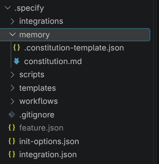
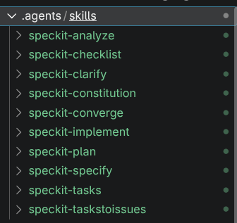
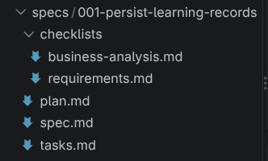

# Guide to setting up Vercel hosting and GitHub Spec Kit for this project
**Workers**: Quách Thiên Lạc  
**Reviewers**: Trần Tôn Minh Kỳ  
**Editors**: Quách Thiên Lạc
---
**Version:** 1.0.0  
**Admendment:** 2026/15/10
---

## Introduction
This guide provides an introduction to hosting our application on Vercel and utilizing the strengths of spec-driven development (SDD) via GitHub Spec Kit (spec-kit). Each of the following sections will be divided into subsections as follows:
- **Introduction:** present the general context and explain relevant terminologies.
- **Setup:** Things that only needs to be done **once** to get the service up and running. Most of the time, only one member of the team needs to do this part (aside from installing the services themselves, which we all need to do).
- **Daily workflow:** General, beginner-oriented guide to using the service. Each member of the team will need to read this subsection.
- **Other commands:** Utitlies commands that are useful but not critical to the overall workflow.

## Vercel hosting
### Introduction 
Web hosting is the use of a cloud service to store the files that make up a website and make that website accessible to Internet users (IBM). There are many ways to do this; we will look at one such way: deploying a Git repository (provided by GitHub) on Vercel.

### Setup 
This setup assumes a Git repository that runs locally and is already connected to GitHub, as well as a Vercel account.

From this point on, we can either use the web GUI or the CLI alternative. For extra aura, this guide will use Vercel CLI.

1. In your project directory, install Vercel CLI using `npm` and verify:
```
npm install -g vercel
vercel --version
```
2. Authenticate using your Vercel account:
``` 
vercel login
```
3. Link the project to Vercel (since we are already in the project directory, simply run the command with no argument):
```
vercel link [path-to-directory]
```
This command will open a series of interactive prompts (if you have ever used CLI agents like Codex, you know how it works). Type Y for yes, N for no, and use the up and down arrows to choose between options. The questions will be approximately like this (answers are also provided as part of an example):
```
? Set up "~/projects/my-project"?
  Yes → Select Yes and press Enter

? Which scope should contain your project?
  Your Account → Select your account and press Enter

? Link to existing project?
  No → Select No and press Enter

? What's your project's name?
  my-website → Type your preferred name and press Enter

? In which directory is your code located?
  ./ → Press Enter to accept the default
```
Note that for the last question, since we are using HTML/CSS/JS, **make sure** that the current directory has the file `index.html` before choosing `./` as the answer.

4. Configure environment variables. Run:
```
vercel env add API_KEY [api-key-name]
```
A prompt will appear for you to enter the value:
```
? What's the value of API_KEY?
```
Paste the key and confirm that Vercel has logged it:
```
vercel env ls
```

5. Deploy a preview:
```
vercel deploy
```
Vercel will return a deployment URL to preview the website. Note that at this stage, we use the URL to test the website's functionality only.

### Daily workflow:

Moving from deploy to production:
```
vercel --prod
```
At this stage, Vercel builds the actual production application and hosts it using the project's production domain. The website is now live. We can inspect it from the terminal using:
```
vercel inspect [link-to-website]
```
#### Important (reiterating):
After running this step, if you are modifying the source code, you only need to run it again to publish the changes.

### Other commands:
1. Debugging: use the following commands:
```
// show deployment history
vercel ls

// show runtime logs
vercel logs
// or error logs
vercel logs --level error
// or stream runtime logs
vercel logs --follow

// view deployment's details
vercel inspect [link-to-website]
// list env var
vercel env ls
// open project dashboard
vercel open
```


## GitHub Spec Kit (spec-kit)
### Introduction
#### SDD
Unlike regular vibe coding, which simply involves typing prompts and waiting for AI models to output results, SDD utilizes natural-language documents known as **"specs"** that clearly define the project and guide the models in the right direction during development. SDD has become more popular in recent years due to the greater control it gives developers over AI coding assistants, enhancing clarity while reducing misalignment. SDD also lowers AI agents' "cognitive load" by introducing a single source of truth as the persistent context, without requiring them to reference past chats and logs extensively.
#### Spec
A spec, short for specification, is a document (artifact) written in natural language whose content describes the implementation details of the software at hand. In other words, specs can be understood as the set of agreements between developers and AI coding assistants on "what to build and how to build it" (IBM). Specs are often more detailed and more specific to a project than general context documents for agents such as PLAN.md or AGENTS.md (Martin Fowler). Although there are different implementation levels, specs are always written before any development happens.

#### spec-kit

spec-kit is GitHub's toolkit for SDD, providing direct CLI integration, high customizability of artifacts, and a range of community add-ons. spec-kit offers three processes: SDD, bug fixing, and idea assessment; we will only talk about the first one in this guide. Its general workflow can be understood as follows:

1. **Constitution:** Setting up the high-level specs for the project; spec-kit calls these the "constitution". The constitution is universal and immutable in the project, meaning every modification must follow it.
2. **Specify - Plan - Tasks - Analyze:** For actual coding tasks, spec-kit generates a number of files based on a template that are mostly checklists to track completion and alignment.
3. **Implementation - Convergence:** After the agent finishes implementing the task at hand, spec-kit checks whether the resulting code satisfies everything in step 2 (Convergence). This process is repeated until no violation of step 2's specs is made.

### Setup
1. First, install the tool using `uv` or `PyPI`. Again, all members need to do this step. Run either of these commands, depending on what you have:
```
uv tool install specify-cli
pip install specify-cli
```
2. Go to our project's folder. Run the following command:
```
specify init  --here
```
A prompt will pop up warning that conflict may happen since the project is not empty; proceed by pressing `y`. This will open up an interactive CLI to choose agent and shell type.  

3. Set the constitution. `/speckit-constitution` establishes the guiding principles for the project. This is done **once** for each project:
```
/speckit-constitution Taskify is a "Security-First" application. All user inputs must be validated. We use a microservices architecture. Code must be fully documented.
```
Writing the constitution will be a task and as such, reviewed by all members; I will do this task and modify `constitution.md` directly so you don't have to worry about this step.

Given below is the result after successfully setting up speckit at this stage:  
  


### Daily workflow
---
**Important:** for Codex users, commands start with `$` rather than `/` (e.g., `$specify-constitution` instead of `/specify-constitution`)
---

The next steps describe a complete workflow for an daily SDD pipeline. It is recommended that we iterate and plan each step from 1-6 as carefully as possible before moving on to steps 7-8.

We will share a `specs/` folder at the project's root level; each feature occupies a subfolder in it and will be worked on separately in each branch. This is important since working on multiple features at once can mess up the context of the agent. A normal feature specs folder will look like this:



Commands will be used within the agent's coding environment (CLI/GUI). All commands can be accompanied with an additional prompt; for some this is required, but for others, the add-on prompt is optional and only provide further context for the task. Some commands output a Markdown file in the feature subfolder; it is important that we review this file carefully before moving on to the next step. I will provide a separate document specifying the convention for writing prompts.

2. Declare what to build. `speckit-specify` focuses on the general whats and whys of the project, not the tech stack.
```
/speckit-specify Develop Taskify, a team productivity platform where predefined users create projects, assign tasks, comment, and move tasks across Kanban columns (To Do, In Progress, In Review, Done). Five users (one product manager, four engineers), three sample projects, no login for this first phase.

```

3. Clarify what to build.
`speckit-clarify` provides an opportunity for resolving ambiguities; optionally provide a focus area for the agent.
```
/speckit-clarify Focus on task card behavior — status changes, comment permissions, and user assignment.
```
4. Choose the tech stack. `/speckit-plan` adds implementation details such as tech stacks and architecture.
```
/speckit-plan Use .NET Aspire with Postgres. The frontend is Blazor Server with drag-and-drop boards and real-time updates. Expose REST APIs for projects, tasks, and notifications.
```
5. Generate a quality checklist. `/speckit-checklist` generates a user-generated quality checklist to confirm that the spec is complete, clear, and consistent. A checked item in this list only means the quality is met, not that a task is completed. Leaving the prompt blank means spec-kit will automatically generate a checklist based on your files. 
``` 
/speckit-checklist
```
6. Divide the work. `/speckit-tasks` generates an actionable, dependency-ordered `tasks.md` from the design artifacts.
```
/speckit-tasks
```

7. Consistency check. `/speckit-analyze` reports conflicts, gaps, and ambiguities across `spec.md`, `plan.md`, and `tasks.md`. It's read-only — if it flags issues, fix them at the source and re-run before implementing.
```
/speckit-analyze
```
8. Build. `/speckit-implement` orders the agent to execute `task.md` in order. Before implementation, it reads the checklist checkbox state as a gate and asks before proceeding if any checklist items are unchecked; it does not change any checklist files or markers. The built-in checklists/requirements.md checklist is maintained by `/speckit-specify` and `/speckit-clarify`, while custom checklists remain reviewer-owned. Run it once to build everything, or scope it to one phase at a time for large features. **No additional prompt is required at this step.**
```
/speckit-implement
```
9. Verify. `/speckit-converge` runs a check in the codebase to see if it has complied with the spec, plan, and tasks. If it finds gaps, it appends new tasks to `tasks.md`; run `/speckit-implement` and converge again until it reports Converged. Otherwise, you're done — proceed to review or open a PR.
```
/speckit-converge
```
That's about 90% of your daily spec-kit workflow. I will update additional commands in the `Other commands` subsection when we encounter issues along the way. Before ending this subsection, here are a few key principles from spec-kit's official documentation:
- Be explicit about what you're building and why
- Don't focus on the tech stack during the specification phase
- Iterate and refine your specifications before implementation
- Validate requirements and plans before coding begins
- Let the coding agent handle the implementation details.

### Other commands
1. Agent management:

To switch from one agent to another, use:
```
specify integration status
```
to check agent status. Then run:
```
specify integration switch [new-agent-name]
```
You can install multiple agents at once and switch when necessary. This is helpful when you run out of tokens halfway through work.


