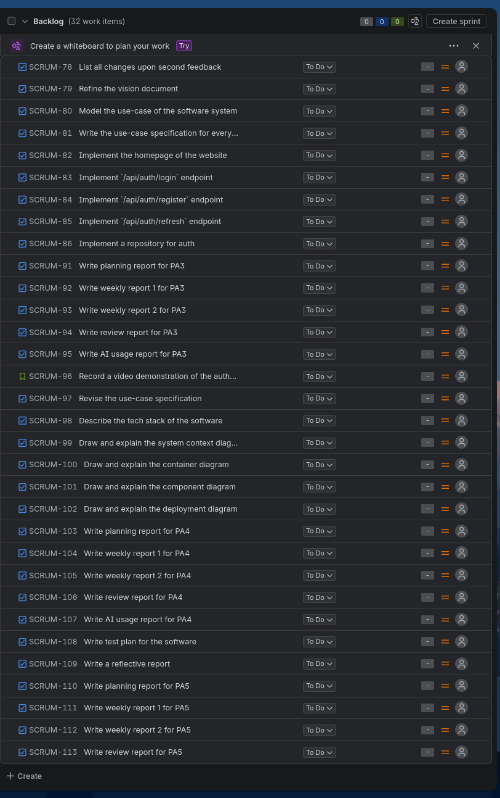

# myHCMUS - Software Development Plan

**Version:** 1.0 

**Team:** debug docker vào 25h sáng

## 1. Introduction
**Workers**: Phạm Vân Trang  
**Reviewers**: Phan Minh Khôi

The project is being developed by a six-member team as part of the CS300 - Elements of Software Engineering course. The team follows Scrum through five sprints corresponding to PA1-PA5. It involves developing myHCMUS, a web-based platform for managing extracurricular activities and student training scores at Ho Chi Minh City University of Science (HCMUS), along with the required documentation.

## 2. Project Overview
**Workers**: Phạm Vân Trang  
**Reviewers**: Phan Minh Khôi

**Goals:**

1. Develop a functional web-based platform that enables HCMUS students to discover and register for extracurricular activities, track their participation, and monitor their training scores, while providing organizers and administrators with tools to manage related activities and records.
2. Deliver the agreed software increments and required project artifacts through five Scrum sprints, with work tracked in Jira and completed by the applicable course deadlines.
3. Apply collaborative software engineering practices through task assignment, peer review, testing, documentation, and regular Scrum activities.
   
**Scope:** 

The project covers the development of the myHCMUS web application and the related software engineering artifacts required throughout PA1–PA5. The application is intended for HCMUS students, activity organizers, and administrators. The project does not include replacing existing university systems, integrating directly with official university databases, production deployment, or university-wide adoption.

**Project Deliverables:** 

The project is expected to produce the following deliverables:

1. **Project Documentation:** The management, requirements, reporting, design, and testing documents required by the project assignments, including the Project Plan, Vision Document, weekly reports, and AI usage reports.

2. **Web Application:** A functional web-based application that supports extracurricular activity management, registration, participation tracking, training-score management, and other proposed features.

3. **Source Code:** The complete source code of the application, including the necessary configuration files and database scripts.

4. **Spec Kit Artifacts:** All Spec Kit artifacts produced throughout the development process, including specifications, implementation plans, task lists, and generated tests.

5. **Testing Documentation:** Test plans, test cases, test execution results, and bug reports documenting the testing process and identified issues.

All deliverables will be developed and maintained throughout the five Scrum sprints and consolidated into a single final submission package at the end of the project.

**Assumptions:**

The project is based on the following assumptions:

1. Team availability: Team members will allocate sufficient time to complete assigned tasks and participate in Scrum activities throughout the semester.
2. Development resources: Team members will have access to the necessary hardware, software, development tools, and internet connectivity.
3. Requirements stability: The core requirements identified during the initial planning stage will remain sufficiently stable. Any changes will be reviewed and prioritized according to the available time and resources.
4. Project timeline: The recommended five-sprint schedule will remain feasible given the course deadlines, team availability, and changes resulting from instructor or TA feedback.

## 3. Project Organization
**Worker**: Phạm Vân Trang  
**Reviewer**: Phan Minh Khôi   
**Editor**: Phạm Vân Trang  

**Team Structure and Members' Role:**

The project is carried out by a student development team using Scrum practices. A Project Manager coordinates planning, task tracking, team communication, and deliverable preparation. Each member has a primary area of responsibility, while all members may contribute to requirements, documentation, frontend, backend, database, and testing work as needed.
In addition, the course instructor and teaching assistants provide feedback and review deliverables. 

| Role | Name | Responsibilities |
|---|---|---|
| Project Manager/Scrum Master | Trần Tôn Minh Kỳ | Coordinate Scrum activities, maintain the project schedule and Jira board, monitor progress. |
| UI/UX Manager | Nguyễn Khang Thịnh | Design application screens, oversee frontend development, and ensure UI/UX consistency. |
| UI/UX Designer | Nguyễn Văn Tĩnh | Develop the application frontend and integrate it with the backend. |
| Database Developer | Quách Thiên Lạc | Design the database schema, prepare data, and manage database structures. |
| Backend Developer | Phan Minh Khôi | Develop the application server, implement backend functionality, manage hosting, and handle AI-related features. |
| Tester | Phạm Vân Trang | Prepare test cases, test features, track defects, and verify fixes before each planned build. |

Note: The roles above define each member's primary responsibilities rather than exclusive tasks. Due to the course's learning objectives and the team's small size, all members are expected to contribute as full-stack developers. 

**Risk Management:**

The team will review risks during sprint planning and update mitigation actions when issues arise. The following are initial project risks; their likelihood and impact can be updated as the team gains more information.

| Risk | Likelihood | Impact | Potential effect | Mitigation strategy |
|---|---|---|---|---|
| **Member unavailability** | Medium | High | Delays in assigned tasks or reviews when a member is absent or has competing deadlines. | Assign a clear owner and reviewer for each task, keep tasks small, document progress in Jira and GitHub, and redistribute tasks early when availability changes. |
| **Technology or integration issues** | Medium | High | Delays caused by unfamiliar tools, API failures, database problems, or the AI service. | Run early technical experiments, implement and test features incrementally, keep fallback approaches, and avoid making core workflows depend on optional AI features. |
| **Scope creep** | High | High | Additional feature requests may prevent completion of essential functionality by PA5. | Prioritize core features, review changes during sprint planning, defer low-priority requests, and revise scope only after assessing time and effort. |
| **Schedule Delays** | Medium | High | Late completion of dependent tasks may reduce the time available for integration, testing, and correction before submission. | Break down large tasks into smaller, manageable tasks with clear deadlines. Monitor progress through Jira and regular Scrum meetings. Prioritize critical features and reserve time for integration and testing before the final sprint. |
| **Data or authorization errors** | Medium | High | Incorrect participation records, training scores, or access permissions may affect system correctness. | Use role-based authorization, validate inputs and business rules, test critical workflows, and use sample or authorized data during development. |

## 4. Project Plan
**Workers** : Trần Tôn Minh Kỳ  
**Reviewers**: Trần Tôn Minh Kỳ, Phạm Vân Trang, Phan Minh Khôi, Nguyễn Khang Thịnh, Nguyễn Văn Tĩnh, Quách Thiên Lạc  
**Editors**: Trần Tôn Minh Kỳ  

The project follows the **Scrum framework** and is divided into five sprints (PA1 to PA5), each lasting approximately 2–3 weeks. At the beginning of each Sprint, the team conducts a planning meeting to identify tasks, assign responsibilities, and establish deadlines. Each task is assigned to precisely one primary member and reviewed by other members to ensure the quality of the deliverables.

### 4.1. Sprint 1: PA1

**Duration:** 3/10 – 17/10

**Sprint Goal:** A proposal of the project, alongside additional management documents

**Planned Tasks:**

| ID       | Task Description                                                  | Assignee | Reviewer | Due Date   |
| -------- | ----------------------------------------------------------------- | -------- | -------- | ---------- |
| SCRUM-7  | Project final proposal                                            | Trang    | Kỳ       | 5/10/2026  |
| SCRUM-8  | Existing app survey                                               | Khôi     | Kỳ       | 8/10/2026  |
| SCRUM-9  | Team contract                                                     | Kỳ       | Kỳ       | 6/10/2026  |
| SCRUM-11 | Kỳ - Proposal preparation                                         | Kỳ       | Kỳ       | 1/10/2026  |
| SCRUM-12 | Lạc - Proposal preparation                                        | Lạc      | Kỳ       | 1/10/2026  |
| SCRUM-13 | Khôi - Proposal preparation                                       | Khôi     | Kỳ       | 1/10/2026  |
| SCRUM-14 | Trang - Proposal preparation                                      | Trang    | Kỳ       | 1/10/2026  |
| SCRUM-15 | Thịnh - Proposal preparation                                      | Thịnh    | Kỳ       | 1/10/2026  |
| SCRUM-17 | Vercel hosting & Spec Kit research                                | Lạc      | Kỳ       | 15/10/2026 |
| SCRUM-19 | Planning meeting report                                           | Kỳ       | Kỳ       | 6/10/2026  |
| SCRUM-21 | Existing app survey refinement                                    | Khôi     | Kỳ       | 7/10/2026  |
| SCRUM-31 | Setup backend and implement `/` endpoint                          | Kỳ       | Kỳ       | 18/10/2026 |
| SCRUM-32 | Implement `/health` endpoint                                      | Khôi     | Kỳ       | 22/10/2026 |
| SCRUM-34 | Export git log after all documents are finalized                  | Trang    | Kỳ       | 18/10/2026 |
| SCRUM-37 | Append work performer, reviewer, and section editor               | Kỳ       | Kỳ       | 10/10/2026 |
| SCRUM-38 | Kỳ - Register an AI Coding account                                | Kỳ       | Kỳ       | 14/10/2026 |
| SCRUM-39 | Lạc - Register an AI Coding account                               | Lạc      | Kỳ       | 14/10/2026 |
| SCRUM-40 | Khôi - Register an AI Coding account                              | Khôi     | Kỳ       | 14/10/2026 |
| SCRUM-41 | Trang - Register an AI Coding account                             | Trang    | Kỳ       | 14/10/2026 |
| SCRUM-42 | Thịnh - Register an AI Coding account                             | Thịnh    | Kỳ       | 14/10/2026 |
| SCRUM-43 | Tĩnh - Register an AI Coding account                              | Tĩnh     | Kỳ       | 14/10/2026 |
| SCRUM-44 | Prepare PA1 submission                                            | Kỳ       | Kỳ       | 18/10/2026 |
| SCRUM-45 | Set up Docker                                                     | Kỳ       | Kỳ       | 18/10/2026 |
| SCRUM-53 | Prepare for v1.0.0 release                                        | Kỳ       | Kỳ       | 18/10/2026 |
| SCRUM-54 | Refine the project proposal                                       | Trang    | Kỳ       | 12/10/2026 |
| SCRUM-55 | Refine the existing apps survey                                   | Khôi     | Kỳ       | 12/10/2026 |
| SCRUM-56 | Design the application core user flow                             | Tĩnh     | Kỳ       | 18/10/2026 |
| SCRUM-57 | Design the application core screens                               | Thịnh    | Kỳ       | 1/11/2026  |
| SCRUM-58 | Outline the database business requirements                        | Lạc      | Kỳ       | 25/10/2026 |
| SCRUM-59 | Complete the weekly report meeting 1                              | Kỳ       | Kỳ       | 13/10/2026 |
| SCRUM-60 | Consult with the TAs about the planning meeting report            | Lạc      | Kỳ       | 12/10/2026 |
| SCRUM-61 | Development tools and process setup                               | Lạc      | Kỳ       | 15/10/2026 |
| SCRUM-62 | Move survey images into `assets/` folder                          | Khôi     | Kỳ       | 13/10/2026 |
| SCRUM-63 | Set up PostgreSQL                                                 | Lạc      | Kỳ       | 25/10/2026 |
| SCRUM-64 | Implement server response callback functions                      | Khôi     | Kỳ       | 25/10/2026 |
| SCRUM-65 | Compose documentation on how to build the application with Docker | Kỳ       | Kỳ       | 25/10/2026 |
| SCRUM-66 | Compose the repository's README                                   | Tĩnh     | Kỳ       | 18/10/2026 |
| SCRUM-67 | Complete weekly report 2                                          | Kỳ       | Kỳ       | 15/10/2026 |
| SCRUM-68 | Reformat weekly reports                                           | Kỳ       | Kỳ       | 18/10/2026 |

**Expected Deliverables:**
- Requirements specification
- Initial product backlog
- Configured Jira board and Git repository
- PA1 report
- Initial project setup, if applicable

### 4.2. Sprint 2: PA2

**Duration:** 17/10 – 31/10

**Sprint Goal:** Vision document, project plan, and basic setup of Spec Kit in repository

**Planned Tasks:**

| ID | Task Description | Assignee | Reviewer | Due Date |
|---|---|---|---|---|
| SCRUM-32 | Implement `/health` endpoint | Khôi | Kỳ | Oct 22, 2026 |
| SCRUM-34 | Export git log after all documents are finalized | Trang | Kỳ | Oct 18, 2026 |
| SCRUM-56 | Design the application core user flow | Tĩnh | Kỳ | Oct 18, 2026 |
| SCRUM-57 | Design the application core screens | Thịnh | Kỳ | Nov 1, 2026 |
| SCRUM-58 | Outline the database business requirements | Lạc | Kỳ | Oct 25, 2026 |
| SCRUM-63 | Set up PostgreSQL | Lạc | Kỳ | Oct 25, 2026 |
| SCRUM-64 | Implement server response callback functions | Khôi | Kỳ | Oct 25, 2026 |
| SCRUM-65 | Compose documentation on how to build the application with Docker | Kỳ | Kỳ | Oct 25, 2026 |
| SCRUM-70 | Write section 1, 2, 3 in project plan | Trang | Khôi | Oct 27, 2026 |
| SCRUM-71 | Listing tasks for current and future sprints | Kỳ | Kỳ, Khôi, Tĩnh, Lạc, Trang, Thịnh | Oct 27, 2026 |
| SCRUM-72 | Product overview and features for vision document | Trang | Thịnh | Oct 27, 2026 |
| SCRUM-73 | Introduction, positioning, and actors for vision document | Lạc | Tĩnh | Oct 27, 2026 |
| SCRUM-74 | Non-functional requirements for vision document | Thịnh | Lạc | Oct 27, 2026 |
| SCRUM-75 | Initialize Spec Kit in repository | Lạc | Khôi | Oct 28, 2026 |
| SCRUM-76 | Write planning meeting report for PA2 | Kỳ | Kỳ, Khôi, Tĩnh, Lạc, Trang, Thịnh | Oct 27, 2026 |
| SCRUM-77 | Addition of conventions into team contract | Kỳ | Thịnh | Oct 27, 2026 |
| SCRUM-87 | Write weekly report 1 for PA2 | Kỳ | Kỳ, Khôi, Tĩnh, Lạc, Trang, Thịnh | Oct 31, 2026 |
| SCRUM-88 | Write weekly report 2 for PA2 | Kỳ | Kỳ, Khôi, Tĩnh, Lạc, Trang, Thịnh | Oct 31, 2026 |
| SCRUM-89 | Write review report for PA2 | Kỳ | Kỳ, Khôi, Tĩnh, Lạc, Trang, Thịnh | Oct 31, 2026 |

**Expected Deliverables:**
- System design documents
- Database design
- UI/UX prototype
- Initial application build
- PA2 report

### 4.3. Build and Release Plan

The team plans to produce three major builds, with one build associated with each Sprint. Additional development builds may be created when necessary for testing and integration.

| Build | Sprint | Expected Date | Purpose |
|---|---|---|---|
| Build 1 | Sprint 3 | 14/11 | Implementation of 1 functional group |
| Build 2 | Sprint 4 | 28/11 | Implementation of 3 functional groups |
| Build 3 | Sprint 5 | 12/12 | Complete implementation |

Each build will undergo appropriate testing before being accepted. Identified bugs will be recorded in Jira and prioritized for resolution.

The final build will include all project features required for the PA5 demonstration.

### 4.4. Task Management and Quality Control

**Task Tracking:** All project tasks, including implementation, testing, documentation, meetings, and self-training, are maintained in the Jira Scrum board.

**Task Assignment:** Each task has one primary assignee responsible for its completion and a different team member responsible for reviewing its results.

**Review Process:** Completed tasks are reviewed before being marked as Done. For coding tasks, reviews may include code inspection, pull request review, and testing. For documentation tasks, reviews focus on correctness, completeness, and consistency.

**Progress Monitoring:** The team monitors progress throughout each Sprint and updates Jira when task status, scope, or priorities change.

**Sprint Completion:** At the end of each Sprint, the team reviews completed work, verifies deliverables, and identifies improvements for subsequent Sprints.

### 4.5. Schedule Management

The project schedule is maintained in Jira and serves as the reference for Sprint activities, task assignments, and deadlines.

The dates presented in this project plan must remain consistent with those recorded in Jira. Any significant schedule changes will be reflected in both the Jira board and the project documentation.

Tasks required for later PAs may be started in earlier Sprints when appropriate to reduce development risks and ensure the project is completed before the final demonstration.