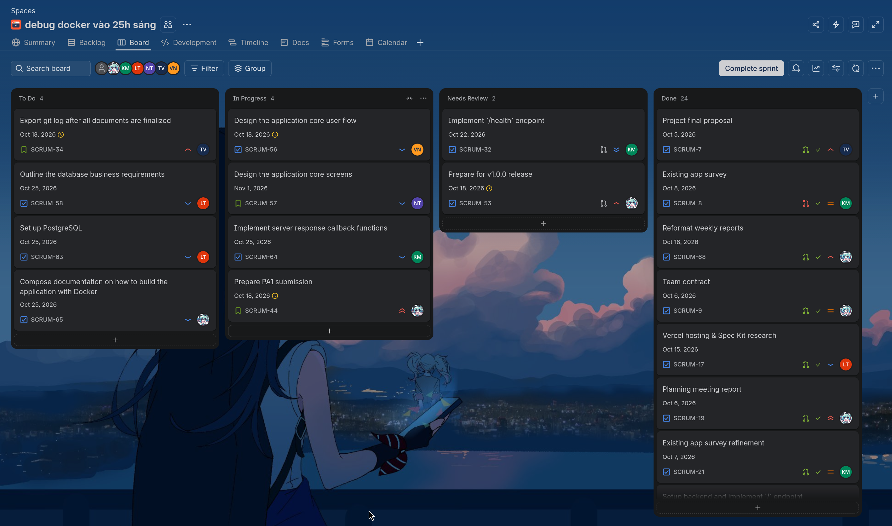

# Review Report
**Workers**: Trần Tôn Minh Kỳ  
**Reviewers**: Quách Thiên Lạc, Phạm Vân Trang, Phan Minh Khôi, Nguyễn Khang Thịnh, Nguyễn Văn Tĩnh  
**Editors**: Trần Tôn Minh Kỳ

## ======== Sprint 1 &mdash; 17/10 Review meeting ========

### Presence
Team members present:
- Kỳ
- Lạc
- Thịnh
- Trang
- Khôi
- Tĩnh

Team members absent:
- None

### What went well?
- Setting up Jira and automation was relatively simple
- Team contract was done smoothly and quickly
- All members already had an AI Coding account and thus the setup was trivial
- All development tools are setup quickly

### What went wrong and what caused it?
- The initial project proposal had a way too large of a scope and thus costed an additional revision
- Existing apps survey also needed to be revised
- Also because of the additional revision, the preliminary core design's goal was also fuzzy and thus resulted in a volatile deliverable

### What did we learn?
- Plan a realistic project idea that covers a niche use case rather than a one-for-all application
- Manage tasks and user stories effectively
- Next sprint, clearer distinction between task types will be made (different colorful covers for chores, fixes, features, etc.)