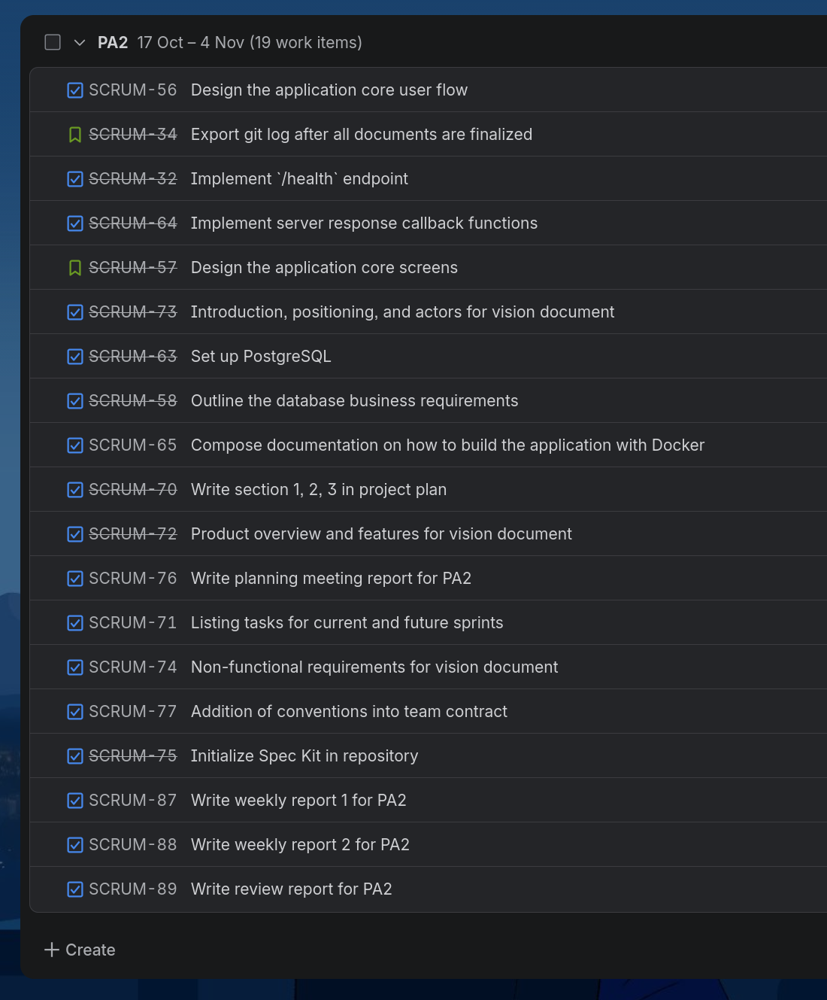

# Planning Report
**Workers**: Trần Tôn Minh Kỳ  
**Reviewers**: Quách Thiên Lạc, Phạm Vân Trang, Phan Minh Khôi, Nguyễn Khang Thịnh, Nguyễn Văn Tĩnh  
**Editors**: Trần Tôn Minh Kỳ  

## ======== Sprint 2 &mdash; 24/10 Planning meeting ========

### Presence
Team members present:
- Kỳ
- Lạc
- Thịnh
- Trang
- Khôi
- Tĩnh

Team members absent: None

### Task identification
The currently identified tasks along with their assignees are:
- **SCRUM-32**: Implement `/health` endpoint -> Khôi
- **SCRUM-56**: Design the application core user flow -> Tĩnh
- **SCRUM-58**: Outline the database business requirements -> Lạc
- **SCRUM-63**: Set up PostgreSQL -> Lạc
- **SCRUM-64**: Implement server response callback functions -> Khôi
- **SCRUM-65**: Compose documentation on how to build the application with Docker -> Kỳ
- **SCRUM-70**: Write section 1, 2, 3 in project plan -> Trang
- **SCRUM-71**: Listing tasks for current and future sprints -> Kỳ
- **SCRUM-72**: Product overview and features for vision document -> Trang
- **SCRUM-73**: Introduction, positioning, and actors for vision document -> Lạc
- **SCRUM-74**: Non-functional requirements for vision document -> Thịnh
- **SCRUM-75**: Initialize Spec Kit in repository -> Lạc
- **SCRUM-76**: Write planning meeting report for PA2 -> Kỳ
- **SCRUM-77**: Addition of conventions into team contract -> Kỳ
- **SCRUM-87**: Write weekly report 1 for PA2 -> Kỳ
- **SCRUM-88**: Write weekly report 2 for PA2 -> Kỳ
- **SCRUM-89**: Write review report for PA2 -> Kỳ

The currently identified user stories along with their assignees are:
- **SCRUM-34**: Export git log after all documents are finalized -> Trang
- **SCRUM-57**: Design the application core screens -> Thịnh

Additional work items are assigned as the sprint progresses.