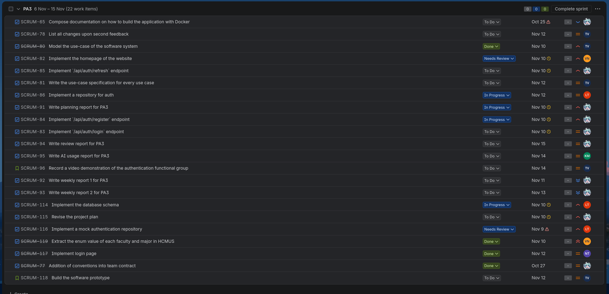

# Planning Report
**Workers**: Trần Tôn Minh Kỳ  
**Reviewers**: Quách Thiên Lạc, Phạm Vân Trang, Phan Minh Khôi, Nguyễn Khang Thịnh, Nguyễn Văn Tĩnh  
**Editors**: Trần Tôn Minh Kỳ  

## ======== Sprint 3 &mdash; 7/10 Planning meeting ========

### Presence
Team members present:
- Kỳ
- Lạc
- Thịnh
- Trang
- Khôi
- Tĩnh

Team members absent: None

### Task identification
The currently identified tasks along with their assignees are:
- **SCRUM-65**: Compose documentation on how to build the application with Docker -> Kỳ
- **SCRUM-77**: Addition of conventions into team contract -> Kỳ
- **SCRUM-78**: List all changes upon second feedback -> Trang
- **SCRUM-80**: Model the use-case of the software system -> Trang
- **SCRUM-81**: Write the use-case specification for every use case -> Trang
- **SCRUM-82**: Implement the homepage of the website -> Tĩnh
- **SCRUM-83**: Implement `/api/auth/login` endpoint -> Kỳ
- **SCRUM-84**: Implement `/api/auth/register` endpoint -> Kỳ
- **SCRUM-85**: Implement `/api/auth/refresh` endpoint -> Kỳ
- **SCRUM-86**: Implement a repository for auth -> Lạc
- **SCRUM-91**: Write planning report for PA3 -> Kỳ
- **SCRUM-92**: Write weekly report 1 for PA3 -> Kỳ
- **SCRUM-93**: Write weekly report 2 for PA3 -> Kỳ
- **SCRUM-94**: Write review report for PA3 -> Kỳ
- **SCRUM-95**: Write AI usage report for PA3 -> Khôi
- **SCRUM-114**: Implement the database schema -> Lạc
- **SCRUM-115**: Revise the project plan -> Kỳ
- **SCRUM-116**: Implement a mock authentication repository -> Lạc
- **SCRUM-117**: Implement login page -> Thịnh
- **SCRUM-119**: Extract the enum value of each faculty and major in HCMUS -> Tĩnh

The currently identified user stories along with their assignees are:
- **SCRUM-96**: Record a video demonstration of the authentication functional group -> Trang
- **SCRUM-118**: Build the software prototype -> Trang

Additional work items are assigned as the sprint progresses.