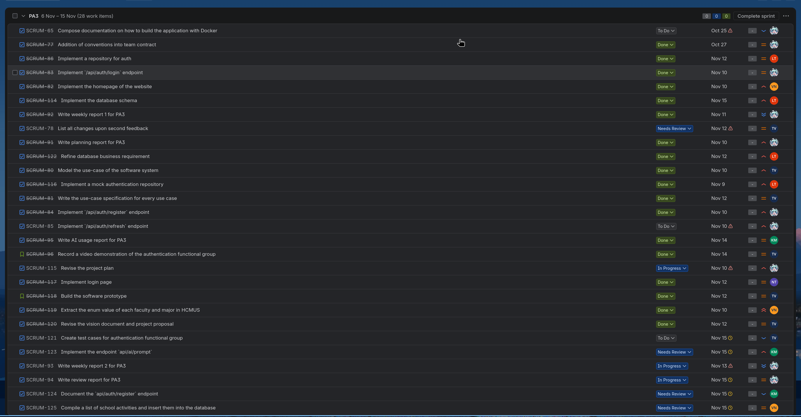

# Review Report
**Workers**: Trần Tôn Minh Kỳ  
**Reviewers**: Quách Thiên Lạc, Phạm Vân Trang, Phan Minh Khôi, Nguyễn Khang Thịnh, Nguyễn Văn Tĩnh  
**Editors**: Trần Tôn Minh Kỳ

## ======== Sprint 3 &mdash; 14/11 Review meeting ========

### Presence
Team members present:
- Kỳ
- Lạc
- Thịnh
- Trang
- Khôi
- Tĩnh

Team members absent:
- None

### What went well?
- Revision of Project proposal
- Writing the use case model and use case specification
- Completion of first functional group, authentication

### What went wrong and what caused it?
- Revision in upstream tasks led to conflicts that must addressed in downstream tasks.

### What did we learn?
- Distributing reviewing workload to other team members enables independent work checking and a more smooth-sailing workflow.