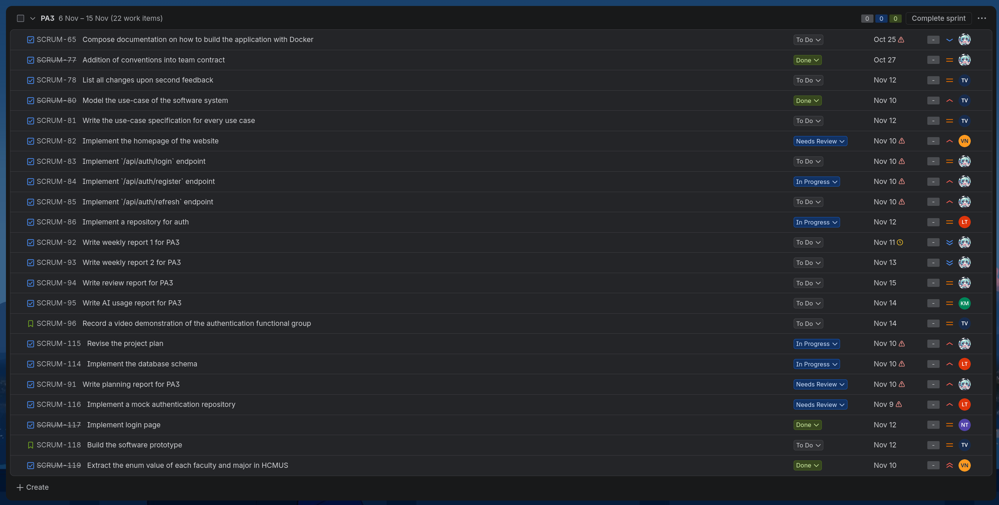

# Weekly Reports
**Workers**: Trần Tôn Minh Kỳ  
**Reviewers**: Quách Thiên Lạc, Phạm Vân Trang, Phan Minh Khôi, Nguyễn Khang Thịnh, Nguyễn Văn Tĩnh  
**Editors**: Trần Tôn Minh Kỳ  

## ======== Sprint 3 &mdash; 10/11 Weekly meeting 1 ========

### Presence
Team members present:
- Kỳ
- Lạc
- Thịnh
- Trang
- Khôi
- Tĩnh

Team members absent:
- None

### Status report - Kỳ
Completed tasks:
- Write the planning meeting report
- Added conventions into team contract

To-do tasks:
- Complete the weekly meeting 1 report
- Implement `api/auth/register` endpoint
- Implement `api/auth/login` endpoint
- Implement `api/auth/refresh` endpoint
- Compose documentation on how to build the application with Docker

Issues/Obstacles:
- Procrastination

### Status reports - Lạc
Completed tasks:
- Implement mock repository for authentication
- Implement the database schema

To-do tasks:
- Implement the repository for authentication

Issues/Obstacles:
- First time trying the repository pattern; have to ensure complete alignment with business requirements
- Have to ensure complete alignment with business requirements

### Status reports - Thịnh
Completed tasks:
- Implement login page

To-do tasks:
- None

Issues/Obstacles:
- None

### Status reports - Trang
Completed tasks:
- Model the use-case of the software system
- Review planning report
  
To-do tasks:
- Record a video demonstration of the authentication functional group
- Create test cases for authentication functional group
- Build the software prototype
- Revise the vision document and project proposal
- Write the use-case specification for every use case

Issues/Obstacles:
- None

### Status reports - Khôi
Completed tasks:
- Researching method and design pattern for AI features

To-do tasks:
- None

Issues/Obstacles:
- Overloaded with information

### Status reports - Tĩnh
Completed tasks:
- Reviewed teammate works
- Extract the enum value of each faculty and major in HCMUS

To-do tasks:
- Implement the homepage of the website

Issues/Obstacles:
- None

### Summary
- Every member reports their work over the week.
- The server and client setup is completed, enabling the implementation of endpoints and screens.