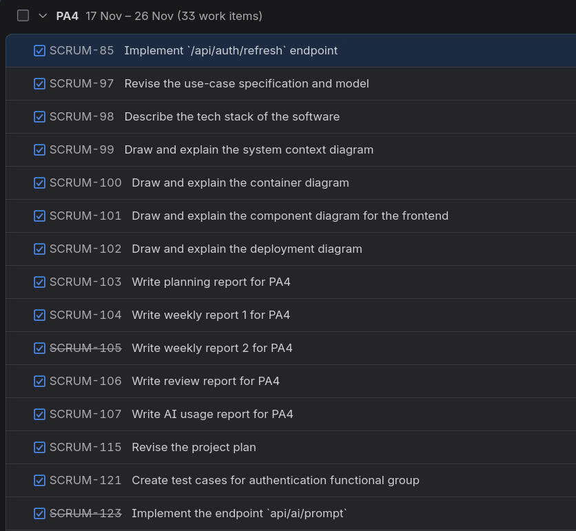

# Planning Report
**Workers**: Quách Thiên Lạc 
**Reviewers**: Quách Thiên Lạc, Phạm Vân Trang, Phan Minh Khôi, Nguyễn Khang Thịnh, Nguyễn Văn Tĩnh  
**Editors**: Quách Thiên Lạc  

## ======== Sprint 4 &mdash; 17/11 Planning meeting ========

### Presence
Team members present:
- Kỳ
- Lạc
- Thịnh
- Trang
- Khôi
- Tĩnh

Team members absent: None

### Task identification
The currently identified tasks along with their assignees are:

- **SCRUM-85**: Implement `/api/auth/refresh` endpoint -> Kỳ
- **SCRUM-97**: Revise the use-case specification and model -> Trang
- **SCRUM-98**: Describe the tech stack of the software -> Khôi
- **SCRUM-99**: Draw and explain the system context diagram -> Trang
- **SCRUM-100**: Draw and explain the container diagram -> Khôi
- **SCRUM-101**: Draw and explain the component diagram for the frontend -> Tĩnh
- **SCRUM-102**: Draw and explain the deployment diagram -> Lạc
- **SCRUM-103**: Write planning report for PA4 -> Lạc
- **SCRUM-104**: Write weekly report 1 for PA4 -> Lạc
- **SCRUM-105**: Write weekly report 2 for PA4 -> Lạc
- **SCRUM-106**: Write review report for PA4 -> Lạc
- **SCRUM-107**: Write AI usage report for PA4 -> Khôi
- **SCRUM-115**: Revise the project plan -> Kỳ
- **SCRUM-121**: Create test cases for authentication functional group -> Trang
- **SCRUM-123**: Implement the endpoint `api/ai/prompt` -> Khôi

Additional work items are assigned as the sprint progresses.