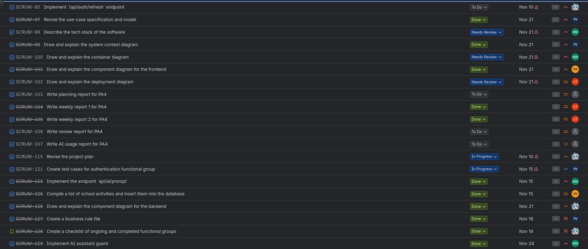
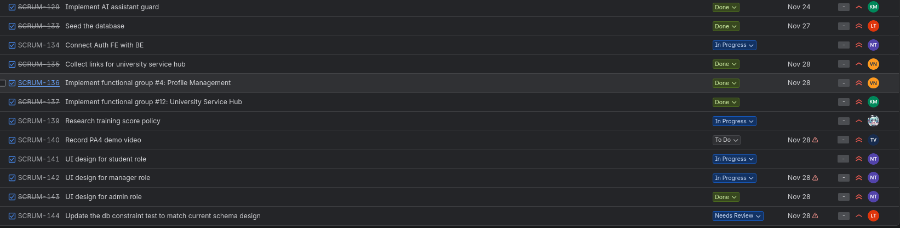

# Review Report
**Workers**: Quách Thiên Lạc  
**Reviewers**: Quách Thiên Lạc, Phạm Vân Trang, Phan Minh Khôi, Nguyễn Khang Thịnh, Nguyễn Văn Tĩnh  
**Editors**: Quách Thiên Lạc

## ======== Sprint 4 &mdash; 28/11 Review meeting ========

### Presence
Team members present:
- Kỳ
- Lạc
- Thịnh
- Trang
- Khôi
- Tĩnh

Team members absent:
- None

### What went well?
- Two more functional groups are finished. Authentication functional group from last sprint is made end-to-end.
- All required diagrams are designed and explained.
- Testing is designed and run for all features. An automated testing system is also developed.
- Partial completion of one function for admin on client-end; this lays the roadwork for full implementation in the next sprint.

### What went wrong and what caused it?
- Dependency on their lower-leveled counterparts means higher-leveled diagrams require constant revision which slow down development process and take precious time away from actual implementation.
- Current Scrum Master encountered personal issues, which resulted in delayed work and sudden task handoff.

### What did we learn?
- Distributing workload and relaxing role division allows team members to work more independently and reduces bottleneck when one member fails to meet their deadlines.
- Constant testing and communication are needed to ensure all features and document align across members' works.