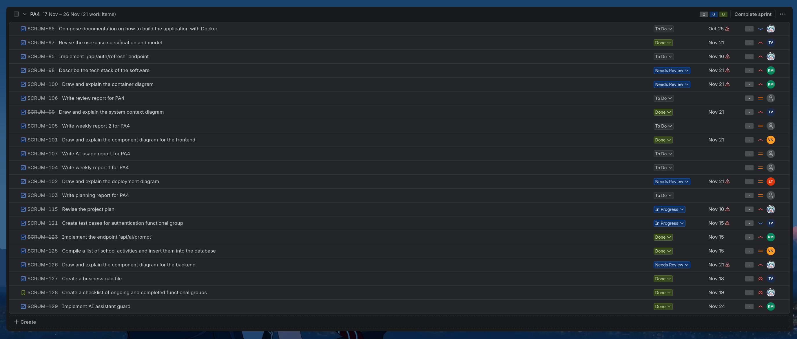
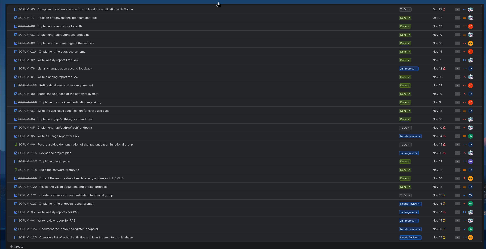

# Weekly Reports
**Workers**: Trần Tôn Minh Kỳ  
**Reviewers**: Quách Thiên Lạc, Phạm Vân Trang, Phan Minh Khôi, Nguyễn Khang Thịnh, Nguyễn Văn Tĩnh  
**Editors**: Trần Tôn Minh Kỳ  

## ======== Sprint 4 &mdash; 20/11 Weekly meeting 1 ========

### Presence
Team members present:
- Kỳ
- Lạc
- Thịnh
- Trang
- Khôi
- Tĩnh

Team members absent:
- None

### Status report - Kỳ
Completed tasks:
- Backend component diagram
- Reviewed others work
- Set up spec kit to accustom to backend architecture

To-do tasks:
- None

Issues/Obstacles:
- Procrastination

### Status reports - Lạc
Completed tasks:
- Draw and explain first draft of deployment diagram

To-do tasks:
- Refine deployment diagram

Issues/Obstacles:
- None

### Status reports - Thịnh
Completed tasks:
- Define endpoints for BE implement

To-do tasks:
- Review Tinh's diagram

Issues/Obstacles:
- None

### Status reports - Trang
Completed tasks:
- Write application-level business rules
- Draw and explain deployment diagrams
  
To-do tasks:
- 

Issues/Obstacles:
- None

### Status reports - Khôi
Completed tasks:
- Implement the endpoint api/ai/prompt(chatbot phase 1)
  Obstacles: none

- Implement AI assistant guard (chatbot phase 2)
  Obstacles: blocked by the late merge of [Implement the endpoint api/ai/prompt], so the works is discontinuous

- Draft the first version of [Describe the tech stack of the software]
  Obstacles: the main reviewer is irresponsive

- Draft the first version of [Draw and explain the container diagram]
  Obstacles: Required the C4 level 1 diagrams (of both FE and BE) on the dev branch to have proper work done

To-do tasks:
Finish all drafted items

### Status reports - Tĩnh
Completed tasks:
- Draw and explain component diagram for frontend
- Find a list of school activities and seed them into the database

To-do tasks:
- None

Issues/Obstacles:
- None

### Summary
- Every member reports their work over the week.
- The server and client setup is completed, enabling the implementation of endpoints and screens.
- 
## ======== Sprint 4 &mdash; 26/11 Weekly meeting 2 ========

### Presence
Team members present:
- Kỳ
- Lạc
- Thịnh
- Trang
- Khôi
- Tĩnh

Team members absent:
- None

### Status report - Kỳ
Completed tasks:
- None

To-do tasks:
- Research training score policy 

Issues/Obstacles:
- Procrastination

### Status reports - Lạc
Completed tasks:
- Finish second version of deployment diagram with substantial revision

To-do tasks:
- Seed the database with all the data

Issues/Obstacles:
- Have to substantially revise to make sure alignment with diagrams at lower levels

### Status reports - Thịnh
Completed tasks:
- Review component diagram of frontend
- Refine endpoints to match the business requirements.

To-do tasks:
- Set up an admin profile to create users
- Connect authetication FE with BE

Issues/Obstacles:
- None

### Status reports - Trang
Completed tasks:
- Review the deployment diagram
- Revise the use-case specification and model
  
To-do tasks:
- Develop an automated testing system
- Record demo video for PA4

Issues/Obstacles:
- None

### Status reports - Khôi
Completed tasks:
- Finish drafts of tasks from weekly meeting 1

To-do tasks:
- Implement functional group #12: University service hub

Issues/Obstacles:
- None

### Status reports - Tĩnh
Completed tasks:
- None

To-do tasks:
- Research how to host DB and do basic setting up
- Collect links for university hub
- Implement functional #4: Profile management

Issues/Obstacles:
- None

### Summary
- Every member reports their work over the week.