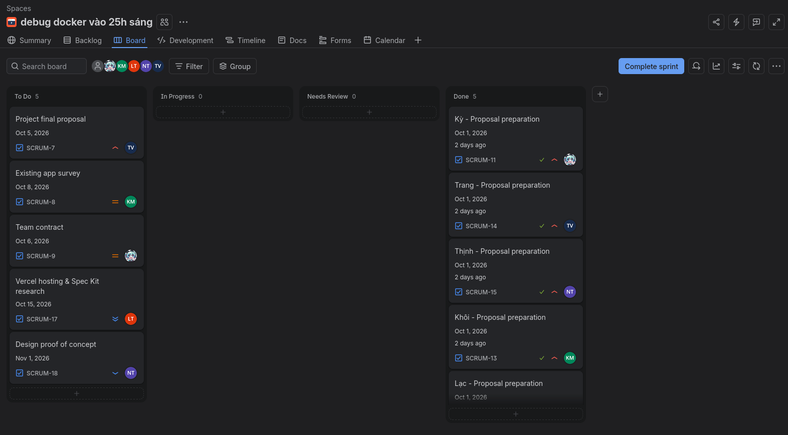

# Weekly Reports
**Workers**: Trần Tôn Minh Kỳ
**Reviewers**: Quách Thiên Lạc, Phạm Vân Trang, Phan Minh Khôi, Nguyễn Khang Thịnh, Nguyễn Văn Tĩnh  
**Editors**: Trần Tôn Minh Kỳ  

## ======== Sprint 1 &mdash; 2/10 Planning meeting ========

### Presence
Team members present:
- Kỳ
- Lạc
- Thịnh
- Trang
- Khôi

Team members absent: None

### Status report - Kỳ
Completed tasks:
- Set up Jira (for upholding Scrum procedure), Git repo (for source control), and Discord (for communication between members)
- Divided preliminary proposal tasks for each member
- Completed individual project proposal

To-do tasks:
- Compose the team contract

Issues/Obstacles:
- Needed to learn and uphold Scrum methodology effectively.
- Did a bit of research in the feasibility of a music maker UI, as well as useful tools for geological purposes.

### Status reports - Lạc
Completed tasks:
- Completed individual project proposal

To-do tasks:
- Research into Spec Kit and Vercel

Issues/Obstacles:
- None

### Status reports - Thịnh
Completed tasks:
- Completed individual project proposal

To-do tasks:
- Design the application's proof of concept

Issues/Obstacles:
- It is found to be quite complicated to first sketch a UI from scratch&mdash;in particular the website UI since Thịnh only has experience in mobile UI. Thus a consensus must be reached on the required features and UI templates. 

### Status reports - Trang
Completed tasks:
- Completed individual project proposal

To-do tasks:
- Compose the final proper project proposal

Issues/Obstacles:
- The proposed idea needs to strike a balance between practicality, feasibility, and attractiveness.

### Status reports - Khôi
Completed tasks:
- Completed individual project proposal

To-do tasks:
- Do a survey on existing apps whose idea overlap with the proposed idea

Issues/Obstacles:
- None

### Actions
- The final proposal must be finalized and formalized.
- The remaining documents are to be completed.

### Summary
- Every member's ideas have been reviewed and cherry-picked to produce the most suitable and feasible idea.
- Other documents required is in progress.

## ======== Sprint 1 &mdash; 10/10 Weekly meeting 1 ========

### Presence
Team members present:
- Kỳ
- Lạc
- Thịnh
- Trang
- Khôi
- Tĩnh

Team members absent:
- None

### Status report - Kỳ
Completed tasks:
- Completed the planning meeting report
- Appended a list of members who contributed in tasks for each document
- Set up the backend and the root `/` endpoint
- Registered an AI Coding account
- Set up an automated start date and completion date system for work item transitions
- Set up Discord webhook for centralized Jira notifications

To-do tasks:
- Complete the weekly meeting 1 report
- Set up Docker

Issues/Obstacles:
- None

### Status reports - Lạc
Completed tasks:
- Completed a Vercel & Spec Kit usage guide
- Registered an AI Coding account
- Reviewed weekly reports and team contract documents
- Provided feedback on mock UI screen

To-do tasks:
- Consult with the TAs about the planning meeting report
- Outline the database business requirements

Issues/Obstacles:
- None

### Status reports - Thịnh
Completed tasks:
- Designed the mock UI for the application
- Registered an AI Coding account
- Reviewed weekly reports

To-do tasks:
- Design the application's core screens

Issues/Obstacles:
- None

### Status reports - Trang
Completed tasks:
- Completed a preliminary version of the project proposal
- Registered an AI Coding account
- Reviewed weekly reports and team contract documents
  
To-do tasks:
- Refine the project proposal
- Export git log after all documents are finalized

Issues/Obstacles:
- None

### Status reports - Khôi
Completed tasks:
- Completed existing apps survey
- Reviewed weekly reports and team contract
- Registered an AI Coding account
- Reviewed the primitive backend implementation

To-do tasks:
- Refine the existing apps survey
- Implement `/health` endpoint

Issues/Obstacles:
- None

### Status reports - Tĩnh
Completed tasks:
- Registered an AI Coding account

To-do tasks:
- Design the application core user flow

Issues/Obstacles:
- None

### Actions
- Upon consultation with TAs about the proposal, it is imperative the proposed idea be descoped and refined further.
- Members may now construct the core application's user flow in tandem with refining the project's idea.

### Summary
- The team discusses the current project state with the new member Tĩnh.
- Every member reports their work over the week.
- The project idea's scope is reduced to only include the university's events, calendar, and conduct score viewing.