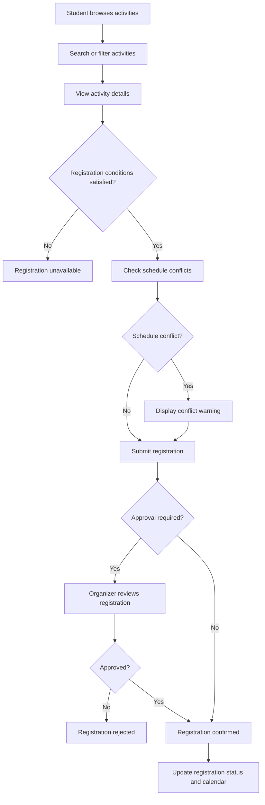
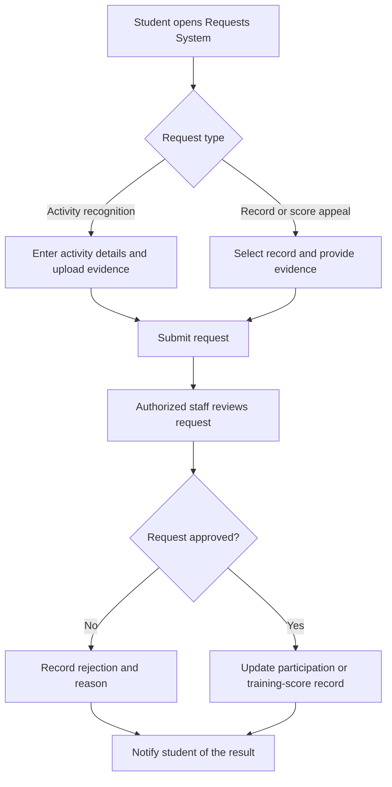

# Vision Document
**Workers:** Quách Thiên Lạc, Phạm Vân Trang, Nguyễn Khang Thịnh  
**Reviewers:** Nguyễn Văn Tĩnh, Quách Thiên Lạc, Nguyễn Khang Thịnh  
**Editors:** Quách Thiên Lạc, Phạm Vân Trang, Nguyễn Khang Thịnh  
**Version:** 1.0.0  
**Amendment:** 2026/31/10

# 1. Introduction
The purpose of this document is to collect, analyze, and define high-level needs and features of the app myHCMUS. It focuses on the capabilities needed by the stakeholders and the target users, and why these needs exist. The details of how myHCMUS fulfills these needs are detailed in the use-case and supplementary specifications.  
This introduction provides an overview of the Vision document, including its purpose and references.

# 2. Positioning
## 2.1 Problem statement
| Aspect | Description |
|---|---|
| The problem of | Discovering and keeping track of many training-score activities, monitoring training scores, and ensuring that activities reach their target audiences and receive engagement. |
| Affects | University students, specifically undergraduates of VNU-HCM University of Science, and organizers of activities that award training scores. |
| The impact of which is | Students have difficulty finding and registering for training-score activities, especially important ones. This consumes time and effort that could be spent on more productive tasks and may prevent students from achieving their required training scores. Organizers may also struggle to reach their target audience and achieve the desired level of engagement. |
| A successful solution would be | Helping students conveniently search for potential training-score activities and manage their registrations, while helping organizers reach students more easily. |
## 2.2 Product position statement
| Aspect | Description |
|---|---|
| For | University students, specifically undergraduates of VNU-HCM University of Science, and organizers of activities that award training scores. |
| Who | Are looking to optimize their training-score search and management process. |
| The app | myHCMUS. |
| Allows | A simpler way to manage extracurricular activities and student training scores. |
| Unlike | The current HCMUS training-score tracking website and Facebook pages, which make the process fragmented and incoherent. |
| Our product | Enables students to discover and register for activities, track their participation, and monitor their training scores, while providing organizers and administrators with tools to efficiently manage activities, attendance, and participation records. |

# 3. Stakeholders and users description
## 3.1 Stakeholders
- **University students**, especially undergraduate students of VNU-HCM University of Science, who need to discover training-score activities, register for them, track participation, and monitor their training scores.
- **Activity organizers**, including student clubs, departments, and other groups that conduct activities awarding training scores. They need to publish activities, reach students, manage registrations, record attendance, and track engagement.
- **University administrators**, who need to manage activities, verify participation records, oversee training-score data, and support reporting and policy enforcement.
- **System administrators and developers**, who are responsible for maintaining the application's availability, authentication, security, and backend services.

## 3.2 Users
- **Students:** Search and filter available activities, register for activities, view registration and participation status, and monitor accumulated training scores.
- **Activity organizers:** Create and manage activities, communicate activity information, review registrations, record attendance, and submit participation results.
- **University administrators:** Review and moderate activities, manage users and records, verify participation data, and oversee the training-score process.

# 4. Product Overview
## 4.1. Product Perspective

myHCMUS is a web-based platform that centralizes extracurricular activity and student training-score management at Ho Chi Minh City University of Science (HCMUS). It enables students to discover and register for activities, track their participation and training scores, and submit requests. Organizers can manage activities and participation records, while administrators oversee system settings and reports.

The platform is designed as an independent web application rather than a replacement for existing university systems. It may provide links to university services but does not require direct integration with official university databases. An AI assistant supports activity recommendations and information retrieval as an additional feature.

## 4.2. Assumptions and Dependencies

### Assumptions

The following assumptions are made regarding the product and its operating environment:

1. Users have access to an internet connection and a supported web browser.
2. Organizers provide and maintain accurate information about extracurricular activities.
3. Users are assigned appropriate roles and permissions based on their responsibilities.
4. Authorized staff are responsible for verifying participation records and reviewing training-score requests.
5. Sample data and project-defined training-score criteria can be used for demonstration and testing without access to official university databases.

### Dependencies

The product depends on the following factors:

1. **Activity Data:** Activity discovery, registration, and recommendations depend on the availability and accuracy of activity information provided by organizers.
2. **Training-Score Criteria:** Training-score management depends on defined scoring criteria and approval procedures.
3. **Database and Hosting:** The application requires a database for storing information and a hosting environment to make the system accessible.
4. **AI Services:** AI-assisted features depend on the availability of the selected AI model or service and relevant input data.
5. **External Service Links:** Access to linked university services depends on the availability and validity of their URLs.

# 5. Product Features
myHCMUS provides the following features to support students, organizers, and administrators in managing extracurricular activities and training scores.

1. **Authentication:** Users can log in and log out of the system using their accounts. The system identifies their roles and grants access to the appropriate features and information. This feature ensures that students, organizers, and administrators can access the system according to their permissions.
   
2. **Profile Management:** Users can update their personal information, change passwords, and manage profile pictures. Students can also view basic academic information, such as their student ID and faculty. This feature helps users maintain accurate account information and supports other features that require user details.
   
3. **Activity Discovery:** Students can browse extracurricular activities and search or filter them by faculty, date, location, training-score criteria, and registration status. Each activity provides information such as its description, schedule, capacity, eligibility requirements, and registration deadline. This feature helps students find suitable activities without searching across multiple information sources.

4. **Activity Registration Management:** Students can register for activities, cancel registrations within the permitted period, and track their registration status. The system checks registration conditions such as deadlines, eligibility requirements, and available capacity. Organizers can view participant lists and review registrations when approval is required. This feature simplifies the registration process and supports organizers in managing participants.
   
5. **Activity Management:** Organizers can create, edit, publish, and manage extracurricular activities, including their schedules, locations, participation requirements, capacity, and training-score criteria. They can also publish announcements, update activity information, and manage activity statuses. The system allows organizers to view participation statistics and export activity reports. This feature supports organizers in managing activities and communicating information to students.

6. **Participation and Training-Score Management:** Organizers can record attendance, verify participation, and manage training-score results for activities. They can update participation records and training scores, as well as import or export relevant data. Students can view their participation history and accumulated training scores by semester and evaluation criteria. This feature supports the management of participation records and allows students to monitor their training-score progress.

7.  **Calendar Management:** Students can view their registered activities in a personal calendar. The system identifies potential scheduling conflicts when activities have overlapping times. This feature helps students organize their schedules and avoid conflicts between activities.

8.  **Notification Management:** Students can receive notifications about upcoming activities, registration deadlines, schedule changes, and registration updates. The system provides relevant notifications based on the activities students follow or register for. This feature helps students stay informed and reduces the risk of missing important activity updates.

9.  **Requests System:** Students can submit requests for recognition of activities held inside or outside the university by providing supporting evidence. They can also appeal missing or incorrect participation records and training scores. Authorized staff can review submitted requests, verify evidence, provide responses, and update request statuses. This feature provides a structured process for students to request recognition or corrections to their participation and training-score records.

10. **System Administration:** Administrators can manage user roles and permissions and configure system-wide settings, including training-score criteria. They can also access reports and statistics on activity participation, registration trends, and training-score distribution. This feature supports administrators in maintaining system settings and monitoring extracurricular activity management.

11. **University Services Hub:** Users can access frequently used university services, such as Moodle, Student Portal, and the university library, through a centralized dashboard. The system provides links to these services without replacing or directly integrating with them. This feature helps users find and access university services more conveniently.

12. **AI Student Assistant:** The AI Student Assistant recommends extracurricular activities based on students' interests, schedules, participation history, and training-score needs. It also allows students to ask questions about activities and relevant university procedures. Students can use these suggestions and responses to identify suitable activities and obtain information more conveniently. This feature helps students make informed decisions about extracurricular participation and better understand university-related procedures.

### Key User Workflows:

The following workflows illustrate two important processes supported by myHCMUS: activity registration and handling student recognition or appeal requests.

**Workflow 1: Activity Discovery and Registration**

**Workflow 2: Activity Recognition and Score Appeal**

# 6. Non-Functional Requirements
## I. Performance

> an indicator of how efficiently a digital solution uses the resources needed to perform its features. In other words, it helps track how quickly the system responds to users’ requests.

| NFR ID              | Requirement  |
| :----------------: | :------  |
| NFR-PER-01 | The overall response time from when a user sends request to receive the response is less than 3 seconds |
| NFR-PER-02 | The system shall load the main pages within 2 seconds under a stable connection |
| NFR-PER-03 | If the system loads more than 1 second, the system shall show the loading indicators |
| NFR-PER-04 | The errors rate of the system shall be less than 5 percents of system requests |
| NFR-PER-05 | The errors rate of users making errors or having difficulties while completing a task shall be less than 10 percents |
| NFR-PER-06 | The delay after clicks, taps or keyboard inputs on the features (e.g., button) is immediately interactive within 0.01 second  |
| NFR-PER-07| User cannot interact with the main page while the system in still in loading progress, response receiving,... |
| NFR-PER-08| The system shall avoid repeating unnecessary database queries when retrieving the same data multiple times with a single user request  |

## II. Scalability

> the ability of the system to demonstrate performance change in direct proportion to the growth of workloads. It allows you to check whether the program can perform its tasks as efficiently if the number of simultaneous visits increases.

### 1. Physical

> Components that must scale, the feature that makes each scalable, the parameter to measure, and the target value.

| NFR ID              | Requirement  |
| :----------------: | :------  |
| NFR-SCA-PHY-01 | The system shall handle at least 1,000 users (including students and organizers) under normal conditions and 5,000 at peak|
| NFR-SCA-PHY-02 | The system shall process over 200 requests per minute for registration on a single event |
| NFR-SCA-PHY-03 | The system never allows to accept the requests that exceed the capability of an event |
| NFR-SCA-PHY-04 | The system shall store at least 3 years of an event history, including event information, registers, training score with no more than 10% slow down for searching & listing pages |
| NFR-SCA-PHY-05 | With an event notification triggered for 1,000 users, at least 95% must be successfully delivered to them. |
| NFR-SCA-PHY-06 | The AI-based assistant shall handle at least 200 concurrent requests, each answers within 30 seconds |
| NFR-SCA-PHY-07 | The system storage shall be up to 400GB-500GB to store files, photos (appeal evidence, avatar) and the storage shall be extensible without interrupting the services |

### 2. Intangible

> Business growth, not technology growth, for a university activity and training-score platform.

| NFR ID | Requirement |
| :---: | :--- |
| NFR-SCA-INT-01 | The system shall allow the number of organizer units (faculties, clubs, departments) to grow from 15 in first development to at least 50 in later scale-up, with each unit managing its own activities and organizers without affecting other units. |
| NFR-SCA-INT-02 | The system shall support growth from 500 to 2,000 activities per semester without changes to the organizer workflow. |
| NFR-SCA-INT-03 | The system shall support growth from a pilot group of up to 1,000 students to 5,000-10,000 students without redesigning the system. |
| NFR-SCA-INT-04 | Administrators shall be able to add a new activity category or evaluation criterion within 1 hour without developer involvement. |
| NFR-SCA-INT-05 | Old scoring rules shall be kept, so past semesters' scores and history remain valid after rules change. |
| NFR-SCA-INT-06 | The system shall allow adding a new interface language without changing the core features, with Vietnamese and English supported at launch. |
| NFR-SCA-INT-07 | The system shall allow adding a new university service or a new notification channel (e.g., email or push) within 1 week of the request. |

## III. Portability

> a characteristic of a software product in terms of its portability from one environment to another. By the environment, in this case, we mean the operating system, the device used, the browser, and their versions.

| NFR ID | Requirement |
| :---: | :--- |
| NFR-POR-01 | The system shall run in the latest stable versions of Chrome, Edge, Firefox browsers without loss of any feature |
| NFR-POR-02 | The system shall be usable on Windows, macOS, Android and iOS through a web browser, with no app installation required |
| NFR-POR-03 | The interface shall adapt to screen widths from 360 px (phone) to 1920 px (desktop) without hidden functions |
| NFR-POR-04 | The system shall be deployable to another hosting environment (e.g., the university's own servers) in no more than 1 working day, using documented steps and configuration files, with no code changes |
| NFR-POR-05 | All secret environment-specific settings (database address, keys, URLs) shall be not kept in the source code |

## IV. Compatibility

> the ability of software to interact with other system components: apps, and processes in the current environment.

| NFR ID | Requirement |
| :---: | :--- |
| NFR-COM-01 | The system shall link to existing university platforms (Moodle, Student Portal, tuition payment) |
| NFR-COM-02 | Reports and participation lists shall be exportable in common formats (PDF) that open in standard office software |
| NFR-COM-03 | Registered activities shall be exportable in the iCalendar (.ics) format, so students can import them into Google Calendar or other calendar-management platforms |
| NFR-COM-04 | The system shall be able to import student and activity lists from CSV or XLSX files, and shall report which rows were rejected and why |
| NFR-COM-05 | The system shall send notifications by email in addition to in-app notifications, using standard email protocols |

## V. Reliability

> the ability of the app to function smoothly for a specified time and under specified conditions.

| NFR ID | Requirement |
| :---: | :--- |
| NFR-REL-01 | A failure shall never leave a partial record. A registration or cancellation shall be atomic (either fully completed or not recorded at all)  |
| NFR-REL-02 | The waiting list shall be promoted in order (first come, first served) when a place becomes free, with no student skipped or counted twice |
| NFR-REL-03 | Training scores shall always equal the sum of verified participation records and approved adjustments |
| NFR-REL-04 | If an external service (email, AI assistant) is unavailable, the rest of the system shall keep working and the failed action shall be retried or reported to the user |
| NFR-REL-05 | The system shall show a clear, understandable message for every error and shall not show technical details to user |
| NFR-REL-06 | Failures shall be recorded in logs with time, user action and error type, so that the team can find the cause |

## VI. Maintainability

> the time it takes to restore the program functionality after an error occurs. The term MTTRS – Mean Time to Restore Service – is often used to measure this indicator.

| NFR ID | Requirement |
| :---: | :--- |
| NFR-MAI-01 | A critical failure (system unavailable or registration  not working) shall be restored within 4 hours (MTTR <= 4 hours) during working days |
| NFR-MAI-02 | A non-critical defect shall be fixed within 3 working days after it is reported and confirmed |
| NFR-MAI-03 | The source code shall be divided into separate modules (e.g., authentication, activities, drs management) so that the change in one module does not require changes in the others |
| NFR-MAI-04 | All source code changes shall go through a pull request and a review by at least one other team member before merging |
| NFR-MAI-05 | Automated tests shall cover at least 90% of the core logic (registration, waiting list, score calculation) and shall pass before each deployment |
| NFR-MAI-06 | A new developer shall be able to run the system on their own machine within 2 hours by following the setup guide. It means that the guidance shall be straightforward without confusion |
| NFR-MAI-07 | After the administrator change training-score criteria, weights or score ranges, the change shall apply to the semesters selected within 1 day. |

## VII. Availability

> the ratio of the time when the system is available to users and the downtime due to failures. A quality app is characterized by rapid recoverability; ideally, this process should be automated.

| NFR ID | Requirement |
| :---: | :--- |
| NFR-AVA-01 | In the first release, the system shall be available at least 98% of the time per month (maybe 12 hours of downtime). This target shall be raised to 99.5% for official deployment |
| NFR-AVA-02 | During registration periods and the appeal period, the system shall be available at least 99% of the time (reduce the downtime to less than 30 minutes-1 hour) |
| NFR-AVA-03 | Planned maintenance shall be announced to users at least 24 hours in advance, shall take place outside peak hours (e.g., 23:00 - 05:00) |
| NFR-AVA-04 | Data shall be backed up automatically at least once a day, and backups shall be kept for at least 30 days |
| NFR-AVA-05 | After a failure, the system shall be restored with no more than 24 hours of lost data (RPO <= 24 hours). The restore procedure shall be tested at least once per semester |
| NFR-AVA-06 | While the system is under maintenance or unavailable, users shall see a notice with the expected time of return instead of an error page (e.g., `503 Service Unavailable`). |

## VIII. Security

> the degree of security of the entire system and the data stored in it from unauthorized access due to hacker attacks.

| NFR ID | Requirement |
| :---: | :--- |
| NFR-SEC-01 | All communication between the user and the system shall be encrypted with HTTPS | 
| NFR-SEC-02 | Every user shall log in with an account. Passwords shall be at least 8 characters and stored only as salted hashes, never as plain text | 
| NFR-SEC-03 | Access shall be controlled by role (student, organizer, administrator). A user shall only see and do what their role allows, and this shall be checked on the server, not only on the screen | 
| NFR-SEC-04 | A student shall only view and change their own personal data, registrations, scores and appeals | 
| NFR-SEC-05 | (OPTIONAL) A session shall end after 30 minutes without activity, and an account shall be temporarily locked for 15 minutes after 5 failed login attempts | 
| NFR-SEC-06 | Every score adjustment, appeal decision and change to system settings shall be recorded in an audit log (who, what, when, before and after values) that cannot be edited by normal users | 
| NFR-SEC-07 | Uploaded evidence files shall be limited in type (PDF, JPG, PNG) and size (10 MB), checked before storing, and only visible to the student and authorized staff | 
| NFR-SEC-08 | The system shall protect against common web attacks (e.g., SQL injection) and shall be checked carefully before deployment |
| NFR-SEC-09 | Personal data shall be collected only as needed and handled according to Vietnam's personal data protection regulations |
| NFR-SEC-10 | The AI Student Assistant shall only use the data of the student asking, and shall not show other students' personal data | 
| NFR-SEC-11 | Secrets such as passwords or API keys shall never be stored in the source repository | 

## IX. Localization

> an indicator of how much a digital product is adapted to the specifics of a particular country. This can include interface and documentation translation, support for national standards, and more.

| NFR ID | Requirement |
| :---: | :--- |
| NFR-LOC-01 | The interface shall be available in Vietnamese (default) and English, and users shall be able to switch language at any time |
| NFR-LOC-02 | The system shall display and store Vietnamese text with full diacritics (UTF-8) correctly, including in search, notifications, exports and PDF files |
| NFR-LOC-03 | Search shall find activities whether or not the user types Vietnamese diacritics (e.g., "hoat dong" finds "hoạt động") |
| NFR-LOC-04 | Dates shall be shown as dd/MM/yyyy, time in 24-hour format, and all times in Vietnam time (UTC+7) |
| NFR-LOC-05 | Semesters, academic years, faculties and training-score criteria shall follow the university's own terms and structure |
| NFR-LOC-06 | All text shown to users shall be stored separately from the code (e.g., in language files) so that a language can be added or corrected without changing features |

## X. Usability

>  the degree of ease of access to the program functions through the user interface. This indicator determines how many user actions  will be needed to achieve the goal.

| NFR ID | Role | Requirement |
| :---: | :---: | :--- |
| NFR-USA-01 | Student | A first-time student shall be able to find an activity and register for it within 2 minutes without any training |
| NFR-USA-02 | All users | The home screen / dashboard should display main tasks for all roles (view score, manage activities) where users can reach each within 3 taps |
| NFR-USA-03 | All users | The interface shall be consistent across pages (same layout, button positions, colors, wording for the same action) |
| NFR-USA-04 | Student | The system shall ask for confirmation before actions that cannot be reversed (cancelling a registration or submitting an appeal) and shall show a clear success or failure message after each action |
| NFR-USA-05 | Student | Forms shall show which fields are wrong and how to correct them, keep the data the user has already entered and shall show which fields are required or optional  |
| NFR-USA-06 | Student | The appeal button shall be disabled outside the appeal period with a message that explains why, and activity cards shall show capacity, score value and deadline before the student registers |
| NFR-USA-07 | Student | A usability test with at least 5 students shall reach a specific score (score of at least 70 in SUS - system usability scale) before official deployment |
| NFR-USA-08 | All users | The system shall provide an online help page (FAQ and short guide for students, organizers and administrators) |
| NFR-USA-09 | All users | The system shall provide a friendly UI dashboard that contains the overall information of users, activities and allows users to direct to their intended features without difficulties or confused behaviors |
| NFR-USA-09 | All users | The system shall provides a clear messages when a user inputs invalid information |
| NFR-USA-10 | Organizer | The system shall clearly display activity status, participant information, and pending actions to help organizers manage activities efficiently |
| NFR-USA-11 | Organizer | After having 30-minute training session, organizers can create the activity within 10 minutes|
| NFR-USA-12 | Organizer | The system shall distinguish clearly between draft, published, ongoing, completed or cancelled actitivies |
| NFR-USA-13 | Administrator | The system shall clearly display a user's current role and permission status before an administrator modifies them |
| NFR-USA-13 | Administrator | The system shall clearly display a confirmation before administrators deciding to alter the criteria |
