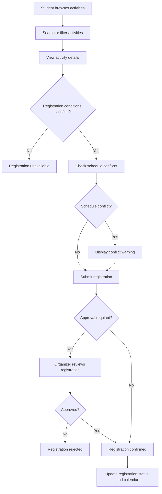
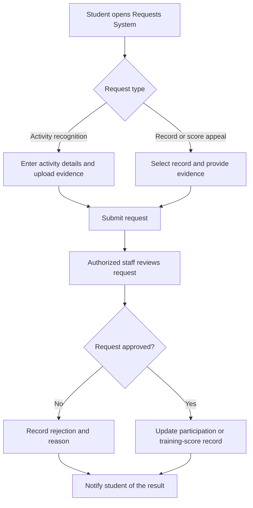

## 4. Product Overview
**Workers**: Phạm Vân Trang  
**Reviewers**: Nguyễn Khang Thịnh 
**Editors**: Phạm Vân Trang  

### 4.1. Product Perspective

myHCMUS is a web-based platform that centralizes extracurricular activity and student training-score management at Ho Chi Minh City University of Science (HCMUS). It enables students to discover and register for activities, track their participation and training scores, and submit requests. Organizers can manage activities and participation records, while administrators oversee system settings and reports.

The platform is designed as an independent web application rather than a replacement for existing university systems. It may provide links to university services but does not require direct integration with official university databases. An AI assistant supports activity recommendations and information retrieval as an additional feature.

### 4.2. Assumptions and Dependencies

#### Assumptions

The following assumptions are made regarding the product and its operating environment:

1. Users have access to an internet connection and a supported web browser.
2. Organizers provide and maintain accurate information about extracurricular activities.
3. Users are assigned appropriate roles and permissions based on their responsibilities.
4. Authorized staff are responsible for verifying participation records and reviewing training-score requests.
5. Sample data and project-defined training-score criteria can be used for demonstration and testing without access to official university databases.

#### Dependencies

The product depends on the following factors:

1. **Activity Data:** Activity discovery, registration, and recommendations depend on the availability and accuracy of activity information provided by organizers.
2. **Training-Score Criteria:** Training-score management depends on defined scoring criteria and approval procedures.
3. **Database and Hosting:** The application requires a database for storing information and a hosting environment to make the system accessible.
4. **AI Services:** AI-assisted features depend on the availability of the selected AI model or service and relevant input data.
5. **External Service Links:** Access to linked university services depends on the availability and validity of their URLs.

## 5. Product Features
**Workers**: Phạm Vân Trang  
**Reviewers**: Nguyễn Khang Thịnh
**Editors**: Phạm Vân Trang  

myHCMUS provides the following features to support students, organizers, and administrators in managing extracurricular activities and training scores.

1. **Authentication:** Users can log in and log out of the system using their accounts. The system identifies their roles and grants access to the appropriate features and information. This feature ensures that students, organizers, and administrators can access the system according to their permissions.
   
2. **Profile Management:** Users can update their personal information, change passwords, and manage profile pictures. Students can also view basic academic information, such as their student ID and faculty. This feature helps users maintain accurate account information and supports other features that require user details.
   
3. **Activity Discovery:** Students can browse extracurricular activities and search or filter them by faculty, date, location, training-score criteria, and registration status. Each activity provides information such as its description, schedule, capacity, eligibility requirements, and registration deadline. This feature helps students find suitable activities without searching across multiple information sources.

4. **Activity Registration Management:** Students can register for activities, cancel registrations within the permitted period, and track their registration status. The system checks registration conditions such as deadlines, eligibility requirements, and available capacity. Organizers can view participant lists and review registrations when approval is required. This feature simplifies the registration process and supports organizers in managing participants.
   
5. **Activity Management:** Organizers can create, edit, publish, and manage extracurricular activities, including their schedules, locations, participation requirements, capacity, and training-score criteria. They can also publish announcements, update activity information, and manage activity statuses. The system allows organizers to view participation statistics and export activity reports. This feature supports organizers in managing activities and communicating information to students.

6. **Participation and Training-Score Management:** Organizers can record attendance, verify participation, and manage training-score results for activities. They can update participation records and training scores, as well as import or export relevant data. Students can view their participation history and accumulated training scores by semester and evaluation criteria. This feature supports the management of participation records and allows students to monitor their training-score progress.

7.  **Calendar Management:** Students can view their registered activities in a personal calendar. The system identifies potential scheduling conflicts when activities have overlapping times. This feature helps students organize their schedules and avoid conflicts between activities.

8.  **Notification Management:** Students can receive notifications about upcoming activities, registration deadlines, schedule changes, and registration updates. The system provides relevant notifications based on the activities students follow or register for. This feature helps students stay informed and reduces the risk of missing important activity updates.

9.  **Requests System:** Students can submit requests for recognition of activities held inside or outside the university by providing supporting evidence. They can also appeal missing or incorrect participation records and training scores. Authorized staff can review submitted requests, verify evidence, provide responses, and update request statuses. This feature provides a structured process for students to request recognition or corrections to their participation and training-score records.

10. **System Administration:** Administrators can manage user roles and permissions and configure system-wide settings, including training-score criteria. They can also access reports and statistics on activity participation, registration trends, and training-score distribution. This feature supports administrators in maintaining system settings and monitoring extracurricular activity management.

11. **University Services Hub:** Users can access frequently used university services, such as Moodle, Student Portal, and the university library, through a centralized dashboard. The system provides links to these services without replacing or directly integrating with them. This feature helps users find and access university services more conveniently.

12. **AI Student Assistant:** The AI Student Assistant recommends extracurricular activities based on students' interests, schedules, participation history, and training-score needs. It also allows students to ask questions about activities and relevant university procedures. Students can use these suggestions and responses to identify suitable activities and obtain information more conveniently. This feature helps students make informed decisions about extracurricular participation and better understand university-related procedures.

#### Key User Workflows:

The following workflows illustrate two important processes supported by myHCMUS: activity registration and handling student recognition or appeal requests.

**Workflow 1: Activity Discovery and Registration**

**Workflow 2: Activity Recognition and Score Appeal**

